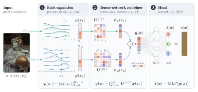
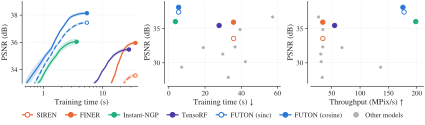
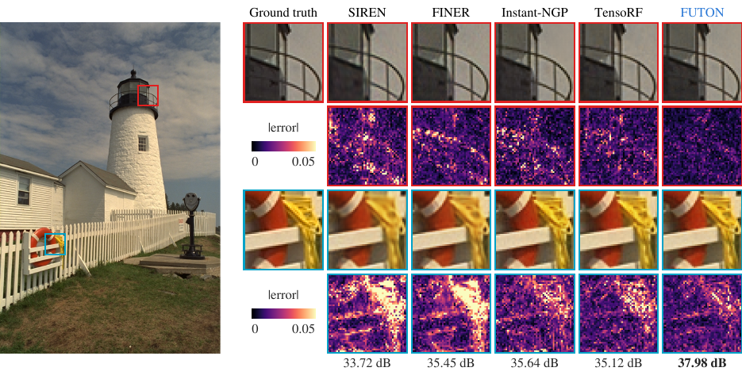
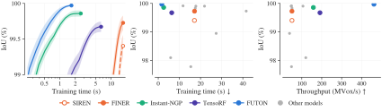
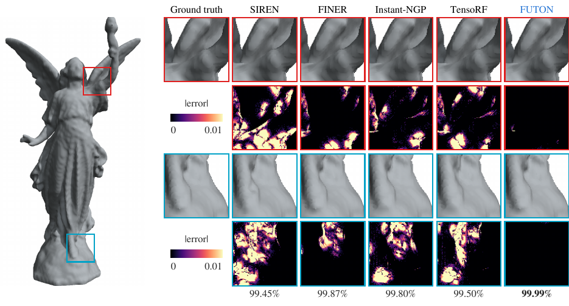
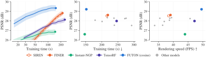
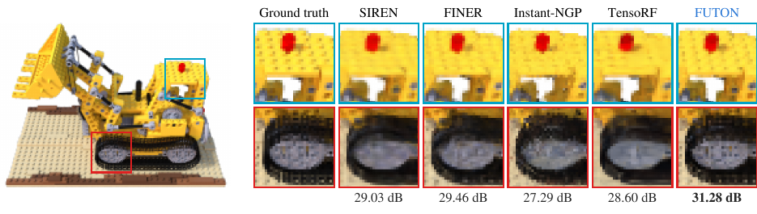
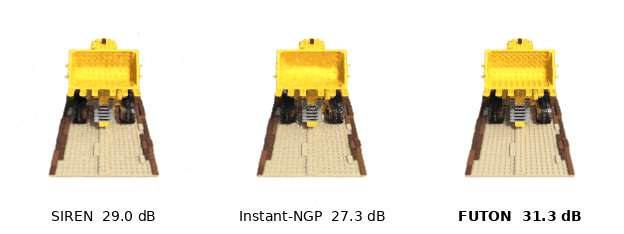

<p align="center">
  <picture>
    <source media="(prefers-color-scheme: dark)" srcset="https://raw.githubusercontent.com/pashtari/inro/main/docs/assets/wordmark-dark.svg">
    
  </picture>
</p>

<p align="center">
  <b>Implicit neural representations in PyTorch</b>, with FUTON, the Fourier Tensor Network.
</p>

<p align="center">
  <a href="https://pypi.org/project/inro/"></a>
  <a href="https://arxiv.org/abs/2602.13414"></a>
  <a href="https://pashtari.github.io/inro/"></a>
  
  
  <a href="https://github.com/pashtari/inro/blob/main/LICENSE"></a>
</p>

<p align="center">
  <a href="https://pashtari.github.io/inro/">Documentation</a> ·
  <a href="#results">Results</a> ·
  <a href="#quick-start">Quick start</a> ·
  <a href="#whats-inside">What's inside</a> ·
  <a href="#citation">Citation</a>
</p>

**Inro** is a PyTorch package for implicit neural representations (INRs), providing a unified framework for implementing, training, and evaluating INR models. It features the official implementation of **FUTON**, introduced in our [paper](https://arxiv.org/abs/2602.13414).

It also includes major INR architectures and baselines, such as SIREN, FINER, RFF, Instant-NGP, and TensoRF, all accessible through a consistent interface. Beyond the models, Inro provides reusable components and unified pipelines for training and evaluating INRs on image and volume representation and compression, and for INR-based inverse problems, including image super-resolution and novel view synthesis.

<p align="center">
  
</p>

## Why FUTON

Most INRs hide their prior in the nonlinearity: sines, Gabor wavelets, Gaussians, or a hash-grid lookup in front of a ReLU network. FUTON puts the prior in the parameterization. The signal is expanded in a fixed, analytic basis along each coordinate axis, and the coefficient tensor of that expansion is stored in low-rank canonical polyadic (CP) form. The model is a shallow, parallel tensor contraction rather than a deep network:

- **Fast.** A point costs O(CKR) for C axes, K basis functions per axis and rank R. On a grid, such as an image's pixels, each axis is evaluated once per distinct coordinate and shared by every point on it.
- **Accurate at equal size.** At matched parameter counts FUTON leads every baseline on the average of each benchmark: Kodak images, Stanford occupancy volumes and Blender radiance fields.
- **Transparent.** With a linear head FUTON *is* a rank-R CP model of the signal in the chosen basis, so bandwidth (K) and capacity (R) are explicit knobs.

## Results

Every model of a task has the same parameter budget. Times are median training times per signal on an A100, from the same runs as the scores. FUTON makes the best trade-off of speed and reconstruction quality on every task. The [benchmarks page](https://pashtari.github.io/inro/experiments/benchmarks/) has every model, metric and error bar.

| Task | #Params | FUTON | Strongest baseline | FUTON's lead |
| --- | --- | --- | --- | --- |
| Images (24 Kodak) | 197k | **37.63 dB** in 4.1 s | MFN, 36.72 dB in 57.3 s | **+0.90 dB, 13.9× faster** |
| Occupancy (5 Stanford shapes) | 131k | **99.97 % IoU** in 1.7 s | RFF, 99.91 % in 11.7 s | **+0.06 %, 7.0× faster** |
| Radiance fields (8 Blender scenes) | 74k | **29.22 dB** in 152 s | FINER, 28.62 dB in 219 s | **+0.60 dB, 1.4× faster** |

### Images

<p align="center">
  
</p>
<p align="center">
  
</p>
<p align="center">
  <sub>Kodak at about 197k parameters: PSNR against training time for FUTON and the strongest model of each family (left), and every model's final PSNR against its training time (middle) and its inference throughput (right). Below, two regions of kodim19 above each model's error, with each model's PSNR over the whole image.</sub>
</p>

### Occupancy

<p align="center">
  
</p>
<p align="center">
  
</p>
<p align="center">
  <sub>Stanford shapes at about 131k parameters: IoU against training time for FUTON and the strongest model of each family (left), and every model's final IoU against its training time (middle) and its inference throughput (right). Below, two regions of Lucy above each model's error, with each model's IoU over the whole volume.</sub>
</p>

### Radiance fields

<p align="center">
  
</p>
<p align="center">
  
</p>
<p align="center">
  
</p>
<p align="center">
  <sub>Blender scenes at about 75k parameters: validation PSNR against training time (left), and every model's final test PSNR against its training time (middle) and its rendering speed (right). Below, the lego scene magnified and in orbit, with each model's test-view PSNR.</sub>
</p>

## Quick start

Python 3.11+ and PyTorch 2.10+; a GPU is optional.

```bash
pip install inro
```

`pip install "inro[3d,nerf]"` adds meshes, nerfacc and video export. The training scripts, configs and notebooks live in this repository: `git clone https://github.com/pashtari/inro.git`, then `pip install -e .`.

Fit FUTON to an image and score it. On a GPU this takes about a dozen seconds and reaches about 38 dB.

```python
import torch
import inro

dataset = inro.ImageCoordinateDataset("data/Kodak/kodim19.png")  # any RGB image
H, W, _ = dataset.target.shape

model = inro.FUTON(
    in_features=2,
    out_features=3,
    basis=("cosine", {"num_components": [H // 2, W // 2]}),  # half the pixels per axis
    combiner=("cp", {"rank": 280}),
    head=("mlp", {"hidden_layers": 1, "hidden_features": 64}),
    output_activation=torch.tanh,
)

result = inro.train(
    model, dataset, dataset,
    num_steps=1000, lr=1e-1,
    metrics={"psnr": inro.psnr, "ssim": inro.ssim},
    eval_interval=250,
)
print(result["history"][-1]["eval"])  # {"psnr": 37.8, "ssim": 0.954, ...}

output = inro.chunked_inference(model, dataset.input, chunk_size=65536)  # (H, W, 3) in [-1, 1]
dataset.save(dataset.postprocess(output.cpu()), "kodim19_futon.png")
```

Every model takes `in_features` and `out_features` first, so `inro.SIREN(2, 3, hidden_features=256, hidden_layers=4, output_activation=torch.tanh)` drops into the same call. The [quick start](https://pashtari.github.io/inro/getting-started/quickstart/) explains each step.

## What's inside

| | |
| --- | --- |
| **FUTON** | `inro.FUTON` with the bases `cosine`, `sinc`, `legendre`, `chebyshev`, `triangle`, `lanczos`; the combiners `cp`, `tr`, `tucker`; and the heads `linear`, `mlp`, `identity` |
| **Baselines** | SIREN, FreSh, FINER, Gauss, WIRE, MFN, RFF, PE-MLP, Instant-NGP, TensoRF, GA-Planes, F-INR, Deep Image Prior |
| **Data** | Coordinate datasets for images, occupancy volumes, MRI k-space, super-resolution and posed views |
| **Training** | `inro.train`, `inro.evaluate`, metrics and losses, quantization-aware training, and [block coordinate descent solvers](https://pashtari.github.io/inro/api/futon/#solvers) for FUTON |
| **Theory** | [`inro.futon_bound`](https://pashtari.github.io/inro/concepts/error-bound/) brackets the best error a linear FUTON can reach on a signal, and builds a FUTON that attains the upper bound |
| **Compression** | [`inro.compression`](https://pashtari.github.io/inro/api/compression/): a FUTON codec, PIL baselines, and one function that measures any codec |
| **Novel views** | [`inro.nerf`](https://pashtari.github.io/inro/tutorials/nerf/): any model as the density network of a radiance field, trained and scored on posed views |

<details>
<summary><b>Reproducing the paper</b></summary>

Three download scripts and three training scripts produce every run behind the results. `configs/<task>.yaml` holds every model's class, arguments and learning rate; finished runs are skipped, so an interrupted sweep resumes. See [Reproducing the paper](https://pashtari.github.io/inro/experiments/reproduce/).

```bash
python scripts/download_kodak.py         # also download_meshes.py, download_blender.py

python scripts/train_image.py --compile  # also train_occupancy.py, train_nerf.py
```

</details>

## Documentation

The full documentation is at **[pashtari.github.io/inro](https://pashtari.github.io/inro/)**: [getting started](https://pashtari.github.io/inro/getting-started/), [concepts](https://pashtari.github.io/inro/concepts/), [tutorials](https://pashtari.github.io/inro/tutorials/), [experiments](https://pashtari.github.io/inro/experiments/) and the [API reference](https://pashtari.github.io/inro/api/). To build it locally: `pip install -e ".[docs]" && mkdocs serve`.

## Citation

```bibtex
@article{ashtari2026futon,
  title   = {{FUTON}: Fourier Tensor Network for Implicit Neural Representations},
  author  = {Ashtari, Pooya and Behmandpoor, Pourya and Deligiannis, Nikos and Pi{\v{z}}urica, Aleksandra},
  journal = {arXiv preprint arXiv:2602.13414},
  year    = {2026}
}
```

## License

MIT. See [LICENSE](https://github.com/pashtari/inro/blob/main/LICENSE).
