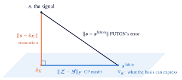
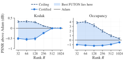
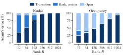
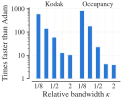

# Error bound of FUTON

How well can a FUTON of a given size fit a signal, before it is trained? For FUTON with a linear head, the signal's samples answer it in seconds: the exact limit that the basis sets at any rank, a ceiling that no FUTON of that size passes, and a FUTON, built without training, that provably reaches a computed PSNR.
{ .inro-lead }

## In short

FUTON's error splits exactly into two parts, as the sides of a right triangle do:

$$
\lVert \boldsymbol{s} - \hat{\boldsymbol{s}} \rVert^2 = \underbrace{\lVert \boldsymbol{s} - \boldsymbol{s}_K \rVert^2}_{\text{truncation}} + \underbrace{\lVert \boldsymbol{\mathcal{Z}} - \boldsymbol{\mathcal{Y}} \rVert_F^2}_{\text{CP misfit}} .
$$

The *truncation* is what the basis cannot express at spectral resolution $K$: the error of the best approximation $\boldsymbol{s}_K$ of the signal by the basis, which no rank lowers. The *CP misfit* is what rank $R$ cannot express of the rest: the distance between the signal's coefficient tensor $\boldsymbol{\mathcal{Z}}$ and the model's, $\boldsymbol{\mathcal{Y}}$, whose CP rank is at most $R$. Training changes only the second part, and its best value is the best rank-$R$ approximation error of $\boldsymbol{\mathcal{Z}}$.

<figure markdown="span">
  { width="560" }
</figure>

The truncation is computed exactly. The best CP misfit is bracketed: from below by the singular values of the coefficient tensor flattened into matrices, and from above by an explicit rank-$R$ tensor built by nested SVDs, whose FUTON has exactly that error. In PSNR, every spectral resolution $K$ and rank $R$ thus get three numbers:

| PSNR | What it guarantees |
| --- | --- |
| Truncation | no FUTON of resolution $K$ exceeds it, at any rank |
| Ceiling | no FUTON of resolution $K$ and rank $R$ exceeds it |
| Certified | the *certified FUTON*, built from the samples without training, reaches it exactly |

<figure markdown="span">
  { width="640" }
</figure>

The best FUTON of that size lies between the certified PSNR and the ceiling, and so, in practice, does training: on the benchmark's 24 Kodak images and five occupancy volumes, in all 522 runs, Adam's FUTON ends between the certified FUTON, to within 0.02 dB, and the ceiling. On the images that bracket is a median 0.05 dB wide, so it says what training will reach before training starts, in a fraction of a second. `inro.futon_bound` computes all three numbers and the certified FUTON from a sampled signal.

## Setting

Equations and definitions are numbered as in the paper.

**Signal and norm.** A signal $\boldsymbol{s}$ maps a product domain $\mathbb{X} = \mathbb{X}_1 \times \cdots \times \mathbb{X}_C$ to $\mathbb{R}^D$, and is measured by

$$
\lVert \boldsymbol{f} \rVert^2 = \sum_{d=1}^{D} \int_{\mathbb{X}} f_d^2 \, d\mu , \qquad \mu = \mu_1 \otimes \cdots \otimes \mu_C ,
$$

with the matching inner product $\langle \cdot, \cdot \rangle$. Two cases matter. On the unit cube with the Lebesgue measure, this is the paper's $L^2([0,1]^C)$. On a sampling grid, $L_c$ points on axis $c$ with $\mu_c$ uniform on them, $\lVert \boldsymbol{f} \rVert^2$ is $D$ times the mean squared error over the $N = \prod_c L_c$ points, the error FUTON is trained and evaluated on. Everything below holds in both cases; in the second, it is computed from the samples.

**Basis.** Axis $c$ uses $K_c$ functions, collected in $\boldsymbol{\varphi}(x_c) \in \mathbb{R}^{K_c}$. They need not be orthonormal: the paper's cosine basis is orthonormal on $[0, 1]$, the sinc and Lanczos bases are not. The products $\phi_{\boldsymbol{k}}(\boldsymbol{x}) = \prod_c \varphi_{k_c}(x_c)$ span the space $\mathbb{V}_K$ of what the basis can express at resolution $K = (K_1, \dots, K_C)$, and $\boldsymbol{s}_K$ is the orthogonal projection of $\boldsymbol{s}$ onto it, channel by channel: the best approximation of the signal in $\mathbb{V}_K$, which for an orthonormal basis is the partial sum of its generalized Fourier series (Eq. 3).

**Coefficients.** The theorem reads the signal through its coefficients in an orthonormal basis of $\mathbb{V}_K$, which one factorization per axis provides. The Gram matrix of axis $c$ factors as

$$
\boldsymbol{G}_c = \int_{\mathbb{X}_c} \boldsymbol{\varphi}(x_c) \, \boldsymbol{\varphi}(x_c)^\top d\mu_c = \boldsymbol{B}_c^\top \boldsymbol{B}_c , \qquad \boldsymbol{B}_c \in \mathbb{R}^{K'_c \times K_c}, \quad K'_c = \operatorname{rank} \boldsymbol{G}_c ,
$$

with $\boldsymbol{B}_c$ of full row rank, so that $\boldsymbol{B}_c \boldsymbol{B}_c^{+} = \boldsymbol{I}$ for its pseudoinverse. Then $\boldsymbol{\xi}(x_c) = (\boldsymbol{B}_c^{+})^\top \boldsymbol{\varphi}(x_c) \in \mathbb{R}^{K'_c}$ is an orthonormal basis of the same span (Lemma 1), and the signal's coefficients in the products of these functions form the *coefficient tensor*

$$
\boldsymbol{\mathcal{Z}} \in \mathbb{R}^{K'_1 \times \cdots \times K'_C \times D}, \qquad z_{\boldsymbol{j} d} = \Big\langle s_d , \prod_{c=1}^{C} \xi_{j_c}(x_c) \Big\rangle .
$$

For an orthonormal basis, $\boldsymbol{B}_c = \boldsymbol{I}$ and $\boldsymbol{\mathcal{Z}}$ holds the generalized Fourier coefficients of Eq. (4).

**Model.** FUTON with a linear head (Eqs. 8 to 10) is

$$
\hat{\boldsymbol{s}}_{\boldsymbol{\theta}}(\boldsymbol{x}) = \boldsymbol{V} \big( \boldsymbol{U}^{(1)\top} \boldsymbol{\varphi}(x_1) \odot \cdots \odot \boldsymbol{U}^{(C)\top} \boldsymbol{\varphi}(x_C) \big),
$$

with parameters $\boldsymbol{\theta} = (\boldsymbol{U}^{(1)}, \dots, \boldsymbol{U}^{(C)}, \boldsymbol{V})$, $\boldsymbol{U}^{(c)} \in \mathbb{R}^{K_c \times R}$ and $\boldsymbol{V} \in \mathbb{R}^{D \times R}$, and no bias or output activation. Its weights form the CP tensor

$$
[\![ \boldsymbol{U}^{(1)}, \dots, \boldsymbol{U}^{(C)}, \boldsymbol{V} ]\!] = \sum_{r=1}^{R} \boldsymbol{u}^{(1)}_r \otimes \cdots \otimes \boldsymbol{u}^{(C)}_r \otimes \boldsymbol{v}_r \in \mathbb{R}^{K_1 \times \cdots \times K_C \times D}
$$

of rank at most $R$, whose last factor is the head.

**Rank-$R$ error.** For a tensor $\boldsymbol{\mathcal{Z}}$, $\varepsilon_R(\boldsymbol{\mathcal{Z}}) = \inf \{ \lVert \boldsymbol{\mathcal{Z}} - \boldsymbol{\mathcal{Y}} \rVert_F : \operatorname{rank} \boldsymbol{\mathcal{Y}} \le R \}$ is the error of its best rank-$R$ CP approximation (rank as in Definition 17). For a nonempty proper subset $\mathbb{S}$ of its modes, $\boldsymbol{\mathcal{Z}}_{\langle \mathbb{S} \rangle}$ is the matrix that flattens it with the modes in $\mathbb{S}$ as rows and the others as columns (Definition 10 for one mode), and $\sigma_1 \ge \sigma_2 \ge \cdots$ are its singular values.

## Theorem

!!! theorem "Theorem (Error of FUTON with a linear head)"

    Let $\boldsymbol{s}$ be square-integrable, $K = (K_1, \dots, K_C)$ and $R \ge 1$.

    **(1) Every FUTON.** For every $\boldsymbol{\theta}$,

    $$
    \big\lVert \boldsymbol{s} - \hat{\boldsymbol{s}}_{\boldsymbol{\theta}} \big\rVert^2 = \underbrace{\lVert \boldsymbol{s} - \boldsymbol{s}_K \rVert^2}_{\text{truncation}} + \underbrace{\big\lVert \boldsymbol{\mathcal{Z}} - [\![ \boldsymbol{B}_1 \boldsymbol{U}^{(1)}, \dots, \boldsymbol{B}_C \boldsymbol{U}^{(C)}, \boldsymbol{V} ]\!] \big\rVert_F^2}_{\text{CP misfit}},
    $$

    and the truncation is $\lVert \boldsymbol{s} - \boldsymbol{s}_K \rVert^2 = \lVert \boldsymbol{s} \rVert^2 - \lVert \boldsymbol{\mathcal{Z}} \rVert_F^2$.

    **(2) The best FUTON.**

    $$
    \inf_{\boldsymbol{\theta}} \big\lVert \boldsymbol{s} - \hat{\boldsymbol{s}}_{\boldsymbol{\theta}} \big\rVert^2 = \lVert \boldsymbol{s} - \boldsymbol{s}_K \rVert^2 + \varepsilon_R(\boldsymbol{\mathcal{Z}})^2 .
    $$

    **(3) Computable bounds.** $\underline{\varepsilon}_R \le \varepsilon_R(\boldsymbol{\mathcal{Z}}) \le \overline{\varepsilon}_R$, where

    $$
    \underline{\varepsilon}_R^2 = \max_{\mathbb{S}} \sum_{i > R} \sigma_i^2\big(\boldsymbol{\mathcal{Z}}_{\langle \mathbb{S} \rangle}\big), \qquad \overline{\varepsilon}_R^2 = \lVert \boldsymbol{\mathcal{Z}} \rVert_F^2 - \sum_{\ell = 1}^{R} \lambda_{(\ell)}^2 ,
    $$

    and $\lambda_{(1)} \ge \lambda_{(2)} \ge \cdots$ are the sorted weights of an orthonormal rank-1 expansion $\boldsymbol{\mathcal{Z}} = \sum_\ell \lambda_\ell \boldsymbol{\mathcal{T}}_\ell$ by nested SVDs (Lemma 3). The upper bound comes with its model: if $[\![ \tilde{\boldsymbol{U}}^{(1)}, \dots, \tilde{\boldsymbol{U}}^{(C)}, \tilde{\boldsymbol{V}} ]\!]$ is the sum of the $R$ heaviest terms, the FUTON with $\hat{\boldsymbol{U}}^{(c)} = \boldsymbol{B}_c^{+} \tilde{\boldsymbol{U}}^{(c)}$ and $\hat{\boldsymbol{V}} = \tilde{\boldsymbol{V}}$ has squared error exactly $\lVert \boldsymbol{s} - \boldsymbol{s}_K \rVert^2 + \overline{\varepsilon}_R^2$. Any other tensor of rank at most $R$ in place of those terms gives a FUTON in the same way, and its misfit is an upper bound too.

    **(4) When the bounds meet.** If at most two modes of $\boldsymbol{\mathcal{Z}}$ have more than one entry, as for $C = 1$, or for $C = 2$ and $D = 1$, then $\underline{\varepsilon}_R = \varepsilon_R(\boldsymbol{\mathcal{Z}}) = \overline{\varepsilon}_R$ and the infimum in (2) is attained. With three or more such modes, as for $C \ge 3$, or for $C = 2$ and $D \ge 2$, it need not be attained.

    All these quantities depend on the basis only through the span of $\boldsymbol{\varphi}$ on each axis.

For an orthonormal basis, $\boldsymbol{B}_c = \boldsymbol{I}$ and $\boldsymbol{\mathcal{Z}}$ holds the generalized Fourier coefficients, so item (2) reads: the best FUTON misses the signal by the truncation of its generalized Fourier series plus the best rank-$R$ CP approximation error of its coefficients. The theorem extends this to any basis, states it for every $\boldsymbol{\theta}$, and brackets the CP part where its exact value is out of reach.

**Truncation, ceiling and certified FUTON.** A signal in $[-1, 1]$ fitted on its grid with squared error $e$ has $\mathrm{PSNR} = 10 \log_{10}(4D / e)$, and the theorem gives three PSNRs at each $(K, R)$:

- the *truncation*, with $e = \lVert \boldsymbol{s} - \boldsymbol{s}_K \rVert^2$, which no FUTON of resolution $K$ exceeds, at any rank;
- the *ceiling*, with $e = \lVert \boldsymbol{s} - \boldsymbol{s}_K \rVert^2 + \underline{\varepsilon}_R^2$, which no FUTON of resolution $K$ and rank $R$ exceeds. It is a value, not a model, and a FUTON is guaranteed to reach it only in the case of item (4);
- the *certified PSNR*, with $e = \lVert \boldsymbol{s} - \boldsymbol{s}_K \rVert^2 + \overline{\varepsilon}_R^2$, the exact PSNR of the *certified FUTON* $\hat{\boldsymbol{\theta}}$ of item (3), the $R$ heaviest terms of the nested-SVD expansion, built from the samples without training.

The best PSNR a FUTON of resolution $K$ and rank $R$ can reach lies between the certified PSNR and the ceiling.

!!! theorem "Corollary (design)"

    A target PSNR $\tau$ is out of reach at $(K, R)$ if the ceiling is below $\tau$, and the certified FUTON reaches it if the certified PSNR is at least $\tau$. Among candidate settings ordered by size, the smallest that can reach $\tau$ therefore lies between the smallest whose ceiling reaches $\tau$ and the smallest whose certified PSNR does, and the latter is a design for $\tau$ that comes with its model.

## Consequences

!!! theorem "Proposition (separation rank)"

    If $\boldsymbol{s}$ is within $\delta$ of a sum of $R$ separable terms, $\lVert \boldsymbol{s} - \sum_{r=1}^{R} g^{(1)}_r(x_1) \cdots g^{(C)}_r(x_C) \, \boldsymbol{v}_r \rVert \le \delta$ with any $g^{(c)}_r \in L^2(\mathbb{X}_c, \mu_c)$ and $\boldsymbol{v}_r \in \mathbb{R}^D$, then the best FUTON of rank $R$ at resolution $K$ has squared error at most $\lVert \boldsymbol{s} - \boldsymbol{s}_K \rVert^2 + \delta^2$, whatever the basis.

Fixing the basis thus costs nothing but the truncation: FUTON never needs more rank than the signal's separation rank at the same accuracy.

!!! note "Remark (why the bound depends on the signal)"

    No bound on the rank a signal needs can hold for all signals. The tensors of rank at most $R$ in $\mathbb{R}^{K'_1 \times \cdots \times K'_C \times D}$ lie in a closed algebraic set of dimension at most $R \, (\sum_c K'_c + D - C)$ (Landsberg, 2012), so wherever that is below $D \prod_c K'_c$, almost every coefficient tensor has a positive rank-$R$ error; almost every $K \times K \times K$ tensor has rank at least $\lceil K^3 / (3K - 2) \rceil$ (Lickteig, 1985), 21,903 at $K = 256$. The theorem therefore works with the signal at hand, and the proposition pays with an assumption on it.

!!! note "Remark (nonlinear heads)"

    The benchmarks' FUTON adds a one-hidden-layer ReLU head, or on volumes a bias, and a $\tanh$ output on images and volumes, which the theorem does not cover. The upper bound transfers to both heads: a bias can be zero, and a ReLU layer of at least $2D$ units contains every linear head, since $\operatorname{relu}(x) - \operatorname{relu}(-x) = x$, so the best such FUTON at $(K, R)$ is at least as good as the certified linear one, with more parameters. The lower bound does not transfer: biases and a hidden layer fit what no linear head can. The $\tanh$ is 1-Lipschitz, so for a target $\boldsymbol{s} = \tanh(\tilde{\boldsymbol{s}})$, which on a grid is every target with $\lvert \boldsymbol{s} \rvert < 1$, the error of $\tanh \circ \hat{\boldsymbol{s}}$ against $\boldsymbol{s}$ is at most that of $\hat{\boldsymbol{s}}$ against $\tilde{\boldsymbol{s}}$, which the theorem bounds; a target that reaches $\pm 1$, as occupancy and the Kodak images do, has no such $\tilde{\boldsymbol{s}}$.

## Proof

Three lemmas give the theorem; open each block to read it.

??? note "Lemma 1 (Orthonormal basis of the span)"

    The entries of $\boldsymbol{\xi}(x_c)$ are orthonormal in $L^2(\mathbb{X}_c, \mu_c)$, and $\boldsymbol{\varphi}(x_c) = \boldsymbol{B}_c^\top \boldsymbol{\xi}(x_c)$ for $\mu_c$-almost every $x_c$. Hence they span the same space as $\boldsymbol{\varphi}$.

    *Proof.* $\int \boldsymbol{\xi} \boldsymbol{\xi}^\top d\mu_c = (\boldsymbol{B}_c^{+})^\top \boldsymbol{B}_c^\top \boldsymbol{B}_c \boldsymbol{B}_c^{+} = (\boldsymbol{B}_c \boldsymbol{B}_c^{+})^\top (\boldsymbol{B}_c \boldsymbol{B}_c^{+}) = \boldsymbol{I}$. Let $\boldsymbol{P} = \boldsymbol{B}_c^{+} \boldsymbol{B}_c$, the orthogonal projector onto the row space of $\boldsymbol{B}_c$; then $\boldsymbol{B}_c^\top \boldsymbol{\xi} = \boldsymbol{P}^\top \boldsymbol{\varphi} = \boldsymbol{P} \boldsymbol{\varphi}$. Moreover $\int \lVert (\boldsymbol{I} - \boldsymbol{P}) \boldsymbol{\varphi} \rVert_2^2 \, d\mu_c = \operatorname{tr}\big((\boldsymbol{I} - \boldsymbol{P}) \boldsymbol{G}_c (\boldsymbol{I} - \boldsymbol{P})\big) = \lVert \boldsymbol{B}_c (\boldsymbol{I} - \boldsymbol{P}) \rVert_F^2 = 0$, because $\boldsymbol{B}_c \boldsymbol{P} = \boldsymbol{B}_c$. So $\boldsymbol{\varphi} = \boldsymbol{P} \boldsymbol{\varphi} = \boldsymbol{B}_c^\top \boldsymbol{\xi}$ almost everywhere, which puts the span of $\boldsymbol{\varphi}$ inside that of $\boldsymbol{\xi}$; the definition of $\boldsymbol{\xi}$ gives the converse. $\square$

    By Fubini, $\langle \prod_c \xi_{j_c}, \prod_c \xi_{j'_c} \rangle = \prod_c \langle \xi_{j_c}, \xi_{j'_c} \rangle = \delta_{\boldsymbol{j} \boldsymbol{j}'}$, the orthonormality half of the paper's Theorem 1, and by Lemma 1 these products span $\mathbb{V}_K$; so they form an orthonormal basis of it. Write $\boldsymbol{\Phi}(\boldsymbol{x}) = \boldsymbol{\varphi}(x_1) \otimes \cdots \otimes \boldsymbol{\varphi}(x_C)$, $\boldsymbol{\Xi}(\boldsymbol{x}) = \boldsymbol{\xi}(x_1) \otimes \cdots \otimes \boldsymbol{\xi}(x_C)$, and $\bullet$ for the generalized dot product (Definition 12). Then $\boldsymbol{s}_K = \boldsymbol{\Xi} \bullet \boldsymbol{\mathcal{Z}}$, and Parseval's identity reads $\lVert \boldsymbol{\Xi} \bullet \boldsymbol{\mathcal{A}} \rVert = \lVert \boldsymbol{\mathcal{A}} \rVert_F$ for every tensor $\boldsymbol{\mathcal{A}}$ of the size of $\boldsymbol{\mathcal{Z}}$.

??? note "Lemma 2 (CP form under mode products)"

    $[\![ \boldsymbol{U}^{(1)}, \dots, \boldsymbol{U}^{(C)}, \boldsymbol{V} ]\!] \times_1 \boldsymbol{B}_1 \cdots \times_C \boldsymbol{B}_C = [\![ \boldsymbol{B}_1 \boldsymbol{U}^{(1)}, \dots, \boldsymbol{B}_C \boldsymbol{U}^{(C)}, \boldsymbol{V} ]\!]$.

    *Proof.* By the paper's Definition 15, $(\boldsymbol{u}_1 \otimes \cdots \otimes \boldsymbol{u}_C \otimes \boldsymbol{v}) \times_c \boldsymbol{B}_c$ replaces $\boldsymbol{u}_c$ by $\boldsymbol{B}_c \boldsymbol{u}_c$, and the mode product is linear. $\square$

??? note "Lemma 3 (Orthonormal rank-1 expansion)"

    For a tensor $\boldsymbol{\mathcal{Z}}$ with $T \ge 2$ modes and any order of its modes, nested SVDs give $\boldsymbol{\mathcal{Z}} = \sum_\ell \lambda_\ell \boldsymbol{\mathcal{T}}_\ell$ with $\lambda_\ell \ge 0$, every $\boldsymbol{\mathcal{T}}_\ell$ of rank one, and $\langle \boldsymbol{\mathcal{T}}_\ell, \boldsymbol{\mathcal{T}}_{\ell'} \rangle = \delta_{\ell \ell'}$. For every set $\mathbb{L}$ of $R$ terms, $\sum_{\ell \in \mathbb{L}} \lambda_\ell \boldsymbol{\mathcal{T}}_\ell$ has rank at most $R$ and $\lVert \boldsymbol{\mathcal{Z}} - \sum_{\ell \in \mathbb{L}} \lambda_\ell \boldsymbol{\mathcal{T}}_\ell \rVert_F^2 = \lVert \boldsymbol{\mathcal{Z}} \rVert_F^2 - \sum_{\ell \in \mathbb{L}} \lambda_\ell^2$.

    *Proof.* By induction on $T$. For $T = 2$ the SVD is such an expansion. For $T > 2$, let the first mode in the order be $m$ and $\boldsymbol{Z}_{(m)} = \sum_i \sigma_i \boldsymbol{a}_i \boldsymbol{b}_i^\top$ be an SVD. Folding $\boldsymbol{b}_i$ into a tensor $\boldsymbol{\mathcal{G}}_i$ of the other $T - 1$ modes gives $\boldsymbol{\mathcal{Z}} = \sum_i \sigma_i \, \boldsymbol{a}_i \otimes \boldsymbol{\mathcal{G}}_i$ with $\langle \boldsymbol{\mathcal{G}}_i, \boldsymbol{\mathcal{G}}_j \rangle = \delta_{ij}$, the modes put back in place. By induction $\boldsymbol{\mathcal{G}}_i = \sum_{\ell'} \lambda'_{i \ell'} \boldsymbol{\mathcal{T}}'_{i \ell'}$, so $\boldsymbol{\mathcal{Z}} = \sum_{i, \ell'} \sigma_i \lambda'_{i\ell'} \, \boldsymbol{a}_i \otimes \boldsymbol{\mathcal{T}}'_{i \ell'}$, a sum of rank-1 tensors with $\langle \boldsymbol{a}_i \otimes \boldsymbol{\mathcal{T}}'_{i \ell'}, \boldsymbol{a}_j \otimes \boldsymbol{\mathcal{T}}'_{j k'} \rangle = \langle \boldsymbol{a}_i, \boldsymbol{a}_j \rangle \langle \boldsymbol{\mathcal{T}}'_{i \ell'}, \boldsymbol{\mathcal{T}}'_{j k'} \rangle = \delta_{ij} \delta_{\ell' k'}$. The residual is the sum of the terms outside $\mathbb{L}$, whose squared norm is the sum of their squared weights by orthonormality. $\square$

??? note "Proof of the theorem"

    (1) Substituting the CP form (7) into Eq. (6), as the paper does to derive Eqs. (8) to (10), gives $\hat{\boldsymbol{s}}_{\boldsymbol{\theta}} = \boldsymbol{\Phi} \bullet \boldsymbol{\mathcal{W}}$ with $\boldsymbol{\mathcal{W}} = [\![ \boldsymbol{U}^{(1)}, \dots, \boldsymbol{U}^{(C)}, \boldsymbol{V} ]\!]$. By Lemma 1, $\boldsymbol{\Phi}(\boldsymbol{x}) = \bigotimes_c \boldsymbol{B}_c^\top \boldsymbol{\xi}(x_c)$ almost everywhere, so $\boldsymbol{\Phi} \bullet \boldsymbol{\mathcal{W}} = \boldsymbol{\Xi} \bullet \boldsymbol{\mathcal{Y}}_{\boldsymbol{\theta}}$ with $\boldsymbol{\mathcal{Y}}_{\boldsymbol{\theta}} = \boldsymbol{\mathcal{W}} \times_1 \boldsymbol{B}_1 \cdots \times_C \boldsymbol{B}_C = [\![ \boldsymbol{B}_1 \boldsymbol{U}^{(1)}, \dots, \boldsymbol{B}_C \boldsymbol{U}^{(C)}, \boldsymbol{V} ]\!]$ by Lemma 2. Then

    $$
    \boldsymbol{s} - \hat{\boldsymbol{s}}_{\boldsymbol{\theta}} = (\boldsymbol{s} - \boldsymbol{s}_K) + \boldsymbol{\Xi} \bullet (\boldsymbol{\mathcal{Z}} - \boldsymbol{\mathcal{Y}}_{\boldsymbol{\theta}}),
    $$

    where the first term is orthogonal to $\mathbb{V}_K$ and the second lies in it. Pythagoras and Parseval give (1). The same argument with $\boldsymbol{\mathcal{Y}} = \boldsymbol{0}$ gives $\lVert \boldsymbol{s} \rVert^2 = \lVert \boldsymbol{s} - \boldsymbol{s}_K \rVert^2 + \lVert \boldsymbol{\mathcal{Z}} \rVert_F^2$.

    (2) The image of $\boldsymbol{\theta} \mapsto \boldsymbol{\mathcal{Y}}_{\boldsymbol{\theta}}$ is exactly the set of tensors of rank at most $R$. It lies inside, since Lemma 2 writes $\boldsymbol{\mathcal{Y}}_{\boldsymbol{\theta}}$ as a sum of $R$ rank-1 terms. It covers the set, since for $\boldsymbol{\mathcal{Y}} = [\![ \tilde{\boldsymbol{U}}^{(1)}, \dots, \tilde{\boldsymbol{U}}^{(C)}, \tilde{\boldsymbol{V}} ]\!]$ the parameters $\hat{\boldsymbol{\theta}} = (\boldsymbol{B}_1^{+} \tilde{\boldsymbol{U}}^{(1)}, \dots, \boldsymbol{B}_C^{+} \tilde{\boldsymbol{U}}^{(C)}, \tilde{\boldsymbol{V}})$ give $\boldsymbol{\mathcal{Y}}_{\hat{\boldsymbol{\theta}}} = \boldsymbol{\mathcal{Y}}$, because $\boldsymbol{B}_c \boldsymbol{B}_c^{+} = \boldsymbol{I}$. Taking the infimum of (1) over $\boldsymbol{\theta}$ is therefore taking it over that set.

    (3) *Lower bound.* Each rank-1 term of a tensor $\boldsymbol{\mathcal{Y}}$ of rank at most $R$ flattens to a rank-1 matrix, so $\operatorname{rank} \boldsymbol{\mathcal{Y}}_{\langle \mathbb{S} \rangle} \le R$, as the paper's Eq. (28) shows for one mode. Flattening preserves the Frobenius norm, and by the Eckart–Young–Mirsky theorem $\lVert \boldsymbol{\mathcal{Z}} - \boldsymbol{\mathcal{Y}} \rVert_F^2 = \lVert \boldsymbol{\mathcal{Z}}_{\langle \mathbb{S} \rangle} - \boldsymbol{\mathcal{Y}}_{\langle \mathbb{S} \rangle} \rVert_F^2 \ge \sum_{i > R} \sigma_i^2(\boldsymbol{\mathcal{Z}}_{\langle \mathbb{S} \rangle})$ for every $\mathbb{S}$. *Upper bound.* By Lemma 3 the $R$ heaviest terms form a tensor of rank at most $R$ at squared distance $\overline{\varepsilon}_R^2$, which is $\boldsymbol{\mathcal{Y}}_{\hat{\boldsymbol{\theta}}}$ for the $\hat{\boldsymbol{\theta}}$ of (2); by (1) that FUTON's squared error is $\lVert \boldsymbol{s} - \boldsymbol{s}_K \rVert^2 + \overline{\varepsilon}_R^2$. Any other tensor of rank at most $R$ works in the same way.

    (4) If two modes have more than one entry, the tensors of rank at most $R$ are the matrices of rank at most $R$ in those modes, and the expansion of Lemma 3 along them is the SVD. Its $R$ heaviest terms are the truncated SVD, so $\overline{\varepsilon}_R = \underline{\varepsilon}_R$ is the Eckart–Young–Mirsky optimum, which is attained. With three or more such modes, the set of tensors of rank at most $R$ is not closed in general, and a best approximation need not exist (de Silva and Lim, *SIAM J. Matrix Anal. Appl.* 30(3), 2008).

    The quantities depend on the basis only through its span: another orthonormal basis of the same span is $\boldsymbol{O} \boldsymbol{\xi}$ with $\boldsymbol{O}$ orthogonal, which rotates $\boldsymbol{\mathcal{Z}}$ mode by mode and changes no norm, no singular value and no weight of the nested SVDs. $\blacksquare$

??? note "Proof of the proposition"

    $\mathbb{V}_K$ is the span of products of one function per axis from the axis spans, so its projection factorizes over the axes, $P_K = P_{K_1} \otimes \cdots \otimes P_{K_C}$, and $P_K$ of a separable term is the separable term of the projected factors. Hence $P_K \sum_r g^{(1)}_r \cdots g^{(C)}_r \boldsymbol{v}_r = \boldsymbol{\Xi} \bullet \boldsymbol{\mathcal{Y}}$ with $\boldsymbol{\mathcal{Y}}$ a sum of $R$ rank-1 tensors, and by item (1) the FUTON with that $\boldsymbol{\mathcal{Y}}$ has squared error $\lVert \boldsymbol{s} - \boldsymbol{s}_K \rVert^2 + \lVert \boldsymbol{\mathcal{Z}} - \boldsymbol{\mathcal{Y}} \rVert_F^2$, where $\lVert \boldsymbol{\mathcal{Z}} - \boldsymbol{\mathcal{Y}} \rVert_F = \lVert P_K (\boldsymbol{s} - \sum_r g^{(1)}_r \cdots g^{(C)}_r \boldsymbol{v}_r) \rVert \le \delta$, a projection being nonexpansive. $\square$

??? note "Remark (color channels)"

    For RGB images, $C = 2$ and $D = 3$, so $\boldsymbol{\mathcal{Z}}$ is of order three and item (4) does not apply. The head $\boldsymbol{V}$ is the factor of the color mode. Expanding that mode first in Lemma 3 is a principal component analysis of the colors, followed by one SVD per color component and a common rank budget across them.

## Algorithm

On the sampling grid, axis $c$'s basis is the matrix $\boldsymbol{\Phi}_c \in \mathbb{R}^{L_c \times K_c}$ with rows $\boldsymbol{\varphi}(x_{c,n})^\top$, and the signal is the array $\boldsymbol{\mathcal{S}} \in \mathbb{R}^{L_1 \times \cdots \times L_C \times D}$ of its samples. A thin SVD $\boldsymbol{\Phi}_c / \sqrt{L_c} = \boldsymbol{Q}_c \boldsymbol{\Sigma}_c \boldsymbol{E}_c^\top$, truncated at the numerical rank $K'_c$, gives $\boldsymbol{B}_c = \boldsymbol{\Sigma}_c \boldsymbol{E}_c^\top$, $\boldsymbol{B}_c^{+} = \boldsymbol{E}_c \boldsymbol{\Sigma}_c^{-1}$ and $\boldsymbol{\xi}(x_{c,n}) = \sqrt{L_c} \, [\boldsymbol{Q}_c]_{n,:}$.

| Step | Computes | Cost |
| --- | --- | --- |
| 1 | $\boldsymbol{Q}_c, \boldsymbol{\Sigma}_c, \boldsymbol{E}_c$ from the thin SVD of $\boldsymbol{\Phi}_c / \sqrt{L_c}$ | $O(L_c K_c^2)$ per axis |
| 2 | $\boldsymbol{\mathcal{Z}} = \boldsymbol{\mathcal{S}} \times_1 \boldsymbol{Q}_1^\top \cdots \times_C \boldsymbol{Q}_C^\top / \sqrt{N}$ | $O(N D \sum_c K_c)$ |
| 3 | $\lVert \boldsymbol{s} - \boldsymbol{s}_K \rVert^2 = \lVert \boldsymbol{\mathcal{S}} \rVert_F^2 / N - \lVert \boldsymbol{\mathcal{Z}} \rVert_F^2$, exact | $O(N D)$ |
| 4 | $\underline{\varepsilon}_R^2$: singular values of every flattening of $\boldsymbol{\mathcal{Z}}$, tails beyond each $R$ | one eigendecomposition per split |
| 5 | Lemma 3 for every mode order, keeping the order with the most weight in its $R$ heaviest terms; $\overline{\varepsilon}_R^2 = \lVert \boldsymbol{\mathcal{Z}} - \boldsymbol{\mathcal{Y}} \rVert_F^2$ for their sum $\boldsymbol{\mathcal{Y}}$, in float64 | nested SVDs of $\boldsymbol{\mathcal{Z}}$ |
| 6 | $\hat{\boldsymbol{U}}^{(c)} = \boldsymbol{E}_c \boldsymbol{\Sigma}_c^{-1} \tilde{\boldsymbol{U}}^{(c)}$, $\hat{\boldsymbol{V}} = \tilde{\boldsymbol{V}}$ | $O(R \sum_c K_c K'_c)$ |

Dividing by $D$ turns the outputs into mean squared errors: every FUTON has an error of at least $(\lVert \boldsymbol{s} - \boldsymbol{s}_K \rVert^2 + \underline{\varepsilon}_R^2)/D$, and the certified FUTON $\hat{\boldsymbol{\theta}}$ has exactly $(\lVert \boldsymbol{s} - \boldsymbol{s}_K \rVert^2 + \overline{\varepsilon}_R^2)/D$. Everything a bound rests on, steps 1 to 5, is computed in float64. Only steps 2 and 3 read the signal, one matrix product per axis and a sum of squares that can share its pass. The rest works on the coefficient tensor, whose size is set by $K$, not by the signal, which is what makes the bound cheap next to training ([cost](#cost)): Adam's every step passes over a batch of the signal, through the whole model, for a thousand steps.

```python
import torch
import inro

data = inro.ImageCoordinateDataset("data/Kodak/kodim19.png")
H, W, _ = data.target.shape
model = inro.FUTON(2, 3, ("cosine", {"num_components": [H // 2, W // 2]}),
                   ("cp", {"rank": 64}), ("linear", {"bias": False}))
features = [model.encoding.basis.axis_features(torch.linspace(-1, 1, n), c)
            for c, n in enumerate((H, W))]
bound = inro.futon_bound(data.target, features, ranks=[32, 64, 256])
bound.truncation, bound.lower, bound.upper   # mean squared errors
bound.initialize(model)                      # the certified FUTON, error bound.upper[1]
```

## Experiment

The experiment asks what the bound tells before any training: whether its guarantees hold, where it places what training reaches, how it sizes a FUTON for a target PSNR, and what it costs. Every number below is a dataset's: a mean, a count or a quantile over its signals.

<div class="inro-tiles inro-tiles--wide">
  <div class="inro-tile">
    <p class="inro-tile__task">The bracket holds</p>
    <p class="inro-tile__gain">522 of 522</p>
    <p class="inro-tile__note">runs put Adam's FUTON between the certified FUTON, to within 0.02 dB, and the ceiling.</p>
  </div>
  <div class="inro-tile">
    <p class="inro-tile__task">Training, located</p>
    <p class="inro-tile__gain">0.05 dB</p>
    <p class="inro-tile__note">median width of that bracket on the images, known before training starts.</p>
  </div>
  <div class="inro-tile">
    <p class="inro-tile__task">Cheap</p>
    <p class="inro-tile__gain">40 to 120×</p>
    <p class="inro-tile__note">less time than training, to size a FUTON for a target PSNR, with a model that reaches it.</p>
  </div>
</div>

### Setup

| | |
| --- | --- |
| **Signals** | The 24 Kodak images ($C = 2$, $D = 3$, $768 \times 512$ or $512 \times 768$ pixels in $[-1, 1]$) and the five Stanford occupancy volumes of the benchmark ($C = 3$, $D = 1$, occupancy $\pm 1$ on grids of 154 to 461 voxels per side) |
| **Settings** | The paper's cosine basis at $K_c = \kappa L_c$ for the relative bandwidths $\kappa \in \{1/8, 1/4, 1/2\}$, with $R \in \{32, 64, 128, 256, 512, 1024\}$ on every signal, around the ranks of the benchmark's FUTON, 280 on every image and 215 to 310 on the volumes: 18 settings per signal, 522 runs, and for the cost alone also $\kappa = 1$ and $2$ |
| **Bound** | `inro.futon_bound` gives the truncation, the ceiling and the certified FUTON $\hat{\boldsymbol{\theta}}$ for all six ranks of a $K$ in one call, which is timed |
| **Training** | The same FUTON with Adam under the benchmark's protocol: 1000 steps, each on the whole image for images and on $2^{20}$ random voxels for volumes, at $10^{-1}$ on images and $3 \cdot 10^{-2}$ on volumes, the benchmark's learning rates for FUTON, annealed to a hundredth, one seed |
| **Scores** | Mean squared errors on the whole grid; PSNR is $10 \log_{10}(4 / \mathrm{MSE})$ for signals in $[-1, 1]$ |
| **Hardware** | NVIDIA A100s. The bound runs mostly on the CPU, in float64, so its timings depend on the CPU's load; the volumes' bounds were timed again in a run of their own, which agrees with an earlier run to within 10 % |
| **Reproduce** | `python scripts/futon_bound.py` writes the records to `logs/bound/` |

### The bracket holds

The ceiling is a theorem, and no trained FUTON passes it beyond rounding in any of the 522 runs. In 15 of them, all on Kodak at full rank, $R \ge 512$ at $\kappa = 1/8$ and $R = 1024$ at $\kappa = 1/4$, where the ceiling is the truncation itself and the full-rank FUTON reaches it, Adam's error lies below it by a relative $2.3 \cdot 10^{-8}$ at most, the float32 rounding of its forward pass. The certified FUTON's side is a construction, not a limit on training, and yet training respects it too: Adam's FUTON never ends more than 0.02 dB below the certified one, on any image or volume. In every run, training lands in the bracket, to within 0.02 dB. The tests check that every certified FUTON attains its upper bound, in float64 to a relative $10^{-9}$, as well as the Eckart–Young case, the invariance within a span and a DCT cross-check.

### Images: training, located

For an image's coefficient tensor, of order three, the bracket is narrow: a median 0.05 dB over the images and settings, at most 0.1 dB in 56 % of them and at most 0.5 dB in 78 %. It widens with $K$, to a median of 0.00, 0.05 and 0.37 dB at $\kappa = 1/8$, $1/4$ and $1/2$, and closes as the certified FUTON reaches the truncation, which it does on every image from $R = 256$ on at $\kappa = 1/8$, from 512 on at $1/4$ and at 1024 at $1/2$. Inside the bracket, Adam lands at a steady place, about two thirds of the way from the certified FUTON to the ceiling: a median 0.66 of the way, between 0.60 and 0.70 in half the settings where the bracket is open. At $\kappa = 1/2$ that is 0.24 dB above the certified FUTON and 0.11 dB below the ceiling, at the median. Before anything is trained, the bound thus says what Adam will reach to within a tenth of a decibel in over half the settings, and to within a few tenths at the largest $K$.

### Volumes: a wider bracket

With three axes and one output, every flattening of the coefficient tensor has rank at most the largest $K_c$, so once $R$ passes it the ceiling falls back to the truncation, although the CP misfit itself need not vanish, and the certified FUTON, the heaviest terms of nested SVDs, trails training further than on the images. The bracket is a median 0.98, 3.43 and 5.37 dB wide at $\kappa = 1/8$, $1/4$ and $1/2$, where Adam lands a median 0.67, 1.07 and 1.19 dB above the certified FUTON and, at $\kappa = 1/4$ and $1/2$, the ceiling is the looser side. At $\kappa = 1/8$ the truncation alone caps the volumes at 20.6 dB on average, which the certified FUTON reaches to within 3.69 dB at $R = 32$, 0.60 dB at 256, 0.14 dB at 512 and 0.01 dB at 1024. On the volumes the bracket is a guarantee more than a forecast: a PSNR that a FUTON of the size reaches without training, and one that none passes.

<figure markdown="span">
  { width="620" }
  <figcaption>PSNR above Adam's at κ = 1/2, averaged over the 24 Kodak images (left) and the five occupancy volumes (right), per rank, from 32 to 1024, with one standard error of the difference: the ceiling, the certified FUTON, and, shaded between them, the bracket that holds the best FUTON, and in which Adam's lands.</figcaption>
</figure>

### Where Adam's error goes

The theorem splits every FUTON's error into the truncation, which $K$ forces, and the CP misfit, and the ceiling splits the misfit further: up to the ceiling it is forced by $R$, and above it the bounds leave it open, between the rank and training. As shares of Adam's error at $\kappa = 1/2$, the truncation is 33 % at $R = 32$ and all but 0.1 % at 1024 on Kodak, the part that $R$ forces falls from 60 % to nothing, and at most 7 % stays open: on images, Adam's error is almost entirely accounted for before training. On the volumes the truncation is 14 % at 32 and 64 % at 1024, $R$ forces 25 % at 32 and nothing from 256 on, since the ceiling falls to the truncation there, and the open part, 36 % to 70 %, is the largest share up to $R = 512$.

<figure markdown="span">
  { width="620" }
  <figcaption>Adam's error at κ = 1/2, in percent, as the theorem splits it, averaged over the 24 Kodak images (left) and the five occupancy volumes (right), per rank, from 32 to 1024: the truncation, which K forces; the part of the CP misfit up to the ceiling, which R forces; and the rest, above the ceiling, which the bounds leave open.</figcaption>
</figure>

### How close is training to the best FUTON?

The ceiling also grades training: no FUTON of the size passes it, so a trained FUTON's distance to it is the most that a better optimizer could add. On every signal at $\kappa = 1/2$ and the benchmark's rank $R$, 280 on Kodak and 215 to 310 on the volumes, Adam at the benchmark's 1000 steps and at five times as many, against the certified FUTON and the ceiling; means over each dataset, ± one within-signal standard error:

| Dataset | R | Certified | Ceiling | Adam, 1000 steps | Adam, 5000 steps |
| --- | ---: | ---: | ---: | ---: | ---: |
| Kodak | 280 | 29.56 ± 0.03 | 29.84 ± 0.02 | 29.75 ± 0.01 | 29.80 ± 0.01 |
| Occupancy | 215–310 | 21.22 ± 0.19 | 26.94 ± 0.42 | 22.55 ± 0.13 | 22.94 ± 0.11 |

On Kodak the best FUTON at the benchmark's $K$ and rank lies between 29.80 dB, which Adam reaches in five times the steps, and the ceiling's 29.84 dB. The benchmark's own 1000 steps end within 0.09 dB of the ceiling on average and within 0.18 dB on every image, and the longer run within 0.09 dB on every image. Training at the benchmark's settings is thus within a tenth of a decibel, on average, of the best FUTON it could reach. On the volumes the best FUTON lies between 22.94 dB, which Adam reaches in five times the steps, and the ceiling's 26.94 dB, 4.00 dB above it on average, where the ceiling is loose. Every trained FUTON passes the certified one, 29.56 and 21.22 dB, on every signal, by up to 0.65 dB on the images and by 1.22 to 2.11 dB on the volumes.

### Sizing a FUTON for a target PSNR

The corollary turns the bracket into one on size: among the candidate settings, no FUTON smaller than the smallest whose ceiling reaches a target PSNR reaches it, and the smallest whose certified PSNR reaches it does, with its model. The table sets both against an oracle that trains every setting and takes the smallest that Adam reaches, and counts over each dataset. *Reached* counts the signals for which some setting reaches the target, by Adam, by the certified FUTON and by the ceiling; the next columns say how often the certified pick has the oracle's parameter count or a larger one, over the signals both reach, and the last the median parameter count of the ceiling's, the oracle's and the certified pick.

| Dataset | Target (dB) | Reached by Adam, the certified FUTON, the ceiling | Same pick | Larger | #Params, ceiling (k) | #Params, Adam (k) | #Params, certified (k) |
| --- | ---: | ---: | ---: | ---: | ---: | ---: | ---: |
| Kodak | 22 | 24/24, 24/24, 24/24 | 88% | 12% | 5.2 | 5.2 | 5.2 |
|  | 24 | 23/24, 23/24, 23/24 | 70% | 30% | 5.2 | 10.3 | 10.3 |
|  | 26 | 22/24, 22/24, 22/24 | 77% | 23% | 20.7 | 20.7 | 30.9 |
|  | 28 | 18/24, 18/24, 18/24 | 67% | 33% | 41.2 | 61.7 | 61.8 |
|  | 30 | 13/24, 13/24, 13/24 | 77% | 23% | 82.3 | 82.3 | 82.3 |
| Occupancy | 19 | 5/5, 5/5, 5/5 | 20% | 80% | 3.9 | 7.7 | 14.1 |
|  | 20 | 5/5, 5/5, 5/5 | 0% | 100% | 4.8 | 15.5 | 31.0 |
|  | 21 | 5/5, 5/5, 5/5 | 0% | 100% | 7.8 | 31.1 | 62.2 |
|  | 22 | 5/5, 5/5, 5/5 | 0% | 100% | 14.1 | 62.2 | 124.4 |
|  | 23 | 5/5, 4/5, 5/5 | 0% | 100% | 15.6 | 124.4 | 237.6 |

The oracle's pick lies between the two on every signal at every target, on both datasets, and the certified pick is never smaller than it. On Kodak the bracket on size is tight: the ceiling's pick and the certified one coincide for 56 % of the images and targets, so the size a target needs is known before anything is trained; the certified pick is the oracle's for 76 % and at most twice it otherwise, and has about its median size at every target but 26 dB. On the volumes the ceiling's pick is a median eight times smaller than the certified one, and the certified pick, safe but generous, holds at most twice the oracle's parameters at the median of every target; at 23 dB it reaches four of the five shapes that Adam does. Read along a budget instead, the certified mean picks the spectral resolution that Adam's results pick on Kodak at every parameter count: $\kappa = 1/8$ is the only setting at about 5k parameters, $1/4$ leads at about 10k and 21k and $1/2$ from about 41k on. On the volumes it picks Adam's at about 4k, 8k, 16k, 62k, 124k and 498k, and lags one step at about 31k and 249k, where Adam already leads with the next $\kappa$.

### Cost

The bound computes the truncation, the ceiling and the certified FUTON for all six ranks of a $K$ in one call. On an A100 that takes 0.02 to 0.17 s per image and 0.05 to 3.0 s per volume on average at $\kappa \le 1/2$, against about 1.7 s and 7.7 s for one Adam run on average. Sizing a signal over every candidate setting, as above, costs 0.26 s per image against 31 s of training, and 3.4 s per volume against 138 s: 40 to 120 times less. The bound grows with $K$, as the coefficient tensor does, and stays below training: at $\kappa = 1$ and $2$ it takes 0.8 to 1.0 s per image, under a tenth of the six Adam runs, and 24 s per volume, about half of them, while the certified FUTON trails training further on the images there:

| Dataset | $\kappa$ | Bound (s) | Adam (s) | Certified, dB below Adam: median | max |
| --- | ---: | ---: | ---: | ---: | ---: |
| Kodak | 1/8 | 0.02 | 10 | 0.00 | 0.93 |
|  | 1/4 | 0.07 | 10 | 0.03 | 1.11 |
|  | 1/2 | 0.17 | 10 | 0.24 | 1.28 |
|  | 1 | 0.79 | 10 | 0.85 | 5.83 |
|  | 2 | 0.97 | 10 | 0.81 | 5.25 |
| Occupancy | 1/8 | 0.05 | 46 | 0.67 | 1.29 |
|  | 1/4 | 0.44 | 46 | 1.07 | 1.47 |
|  | 1/2 | 2.95 | 46 | 1.19 | 1.56 |
|  | 1 | 24.19 | 46 | 1.28 | 1.57 |
|  | 2 | 23.82 | 47 | 1.31 | 1.66 |

<figure markdown="span">
  { width="300" }
  <figcaption>How many times faster the bound, certified FUTON included, is than the six Adam runs it stands in for, one per rank, per relative bandwidth κ from 1/8 to 2, from the seconds per signal averaged over each dataset.</figcaption>
</figure>

## Related results

The ingredients are classical; the use is in combining them for this model, where every quantity can be computed from the signal and the bound is attained.

- **Matrices.** For a matrix, the best rank-$R$ approximation and its error are the truncated SVD's (Eckart and Young, 1936; Mirsky, 1960), which is item (4).
- **Higher orders.** For a tensor of order three or more, a best rank-$R$ CP approximation need not exist (de Silva and Lim, 2008), which is why item (2) is an infimum and items (3) bracket it.
- **Flattenings.** The lower bound is the tail of a matricization, the quantity that bounds the truncation error of the HOSVD (De Lathauwer, De Moor and Vandewalle, 2000) and of the TT-SVD (Oseledets, 2011) from below; the nested SVDs of Lemma 3 split off one mode per SVD, as the TT-SVD does, but each branch by its own SVD, a tree of SVDs whose heaviest terms they keep, which for two modes is the Kronecker-product SVD of Van Loan and Pitsianis (1993).
- **Separated representations.** The separation rank of a function and its $\varepsilon$-rank are the notions of the separated representations of Beylkin and Mohlenkamp (2002, 2005); the proposition above says that a fixed basis inherits them up to the truncation.
- **Learning.** Learning with CP-structured Fourier coefficients appears in Kargas and Sidiropoulos (2021), with error bounds under smoothness, and in kernel machines with a fixed Fourier basis in Wesel and Batselier (2021); their analyses hold in expectation or asymptotically, where the theorem here is an identity for the signal at hand.
- **MLP-based INRs.** For MLP-based INRs, the structure of what a network can represent is known (Yüce, Ortiz-Jiménez, Dimitriadis and Frossard, 2022), but no analogue of item (2), the exact error of the best model at a given size, is available.

## Limitations

- **The whole grid.** The theorem needs the signal on its whole grid, since the coefficient tensor is a sum over every sample: it covers representation, not radiance fields or inverse problems, where the signal is observed through a renderer or an operator, and its grid norm says nothing about points off the grid.
- **A linear head.** It covers the model of the paper's error analysis, a linear head without bias or output activation; the remark above says what transfers to the benchmarks' heads, and the lower bound does not.
- **Three or more axes.** For three or more axes the ceiling falls to the truncation once $R$ passes the largest $K_c$, and the certified FUTON trails training by a median 1.06 dB on the volumes, so the bracket is wide there; a tighter lower bound for that regime is open.
- **A conservative certificate.** The certified FUTON keeps the heaviest terms of one expansion, and training passes it by a median 0.03 dB on the images and 1.06 dB on the volumes. Item (3) takes any tensor of rank at most $R$, so a search that improves on those terms, its result taken exactly, tightens the certificate, at the cost of the search.
- **Candidates.** The design corollary chooses among the candidate settings it is given; a finer grid of $K$ and $R$ costs one bound each.
