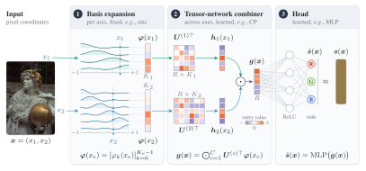
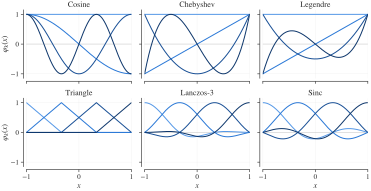
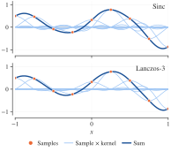
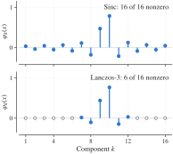

# FUTON

FUTON, the Fourier Tensor Network, represents a signal as a truncated series in a fixed basis whose coefficient tensor is kept in low-rank form. This page derives the model, describes each stage as it is implemented, and explains how to size one.
{ .inro-lead }

<figure markdown="span">
  { width="960" }
  <figcaption>The three stages for one pixel of kodim17. Each array is colored by its entries' sign and size.</figcaption>
</figure>

## From a series to a network

Take a signal $s : [-1, 1]^C \to \mathbb{R}$ and a family of $K$ functions $\varphi_1, \dots, \varphi_K$ on $[-1, 1]$. Products of one function per axis form a separable basis of $[-1, 1]^C$, and the signal expands as a generalized Fourier series:

$$
s(\boldsymbol{x}) \approx \sum_{k_1=1}^{K} \cdots \sum_{k_C=1}^{K} \mathcal{W}[k_1, \dots, k_C] \, \prod_{c=1}^{C} \varphi_{k_c}(x_c).
$$

Stored in full, the coefficient tensor $\mathcal{W}$ has $K^C$ entries: for a $512 \times 768$ image at the sampling resolution that is the image itself, and for a $256^3$ volume it is $16.8$ million coefficients. FUTON's prior is that $\mathcal{W}$ is compressible, and it stores the tensor in canonical polyadic (CP) form of rank $R$,

$$
\mathcal{W} = \sum_{r=1}^{R} \boldsymbol{u}^{(1)}_r \circ \cdots \circ \boldsymbol{u}^{(C)}_r ,
$$

with one factor matrix $\boldsymbol{U}^{(c)} = [\boldsymbol{u}^{(c)}_1, \dots, \boldsymbol{u}^{(c)}_R] \in \mathbb{R}^{K \times R}$ per axis. Substituting the factorization and exchanging the sums turns the $C$-fold summation into a product of $C$ inner products:

$$
\begin{aligned}
s(\boldsymbol{x}) &\approx \sum_{r=1}^{R} \prod_{c=1}^{C} \big\langle \boldsymbol{u}^{(c)}_r, \boldsymbol{\varphi}(x_c) \big\rangle \\
&= \boldsymbol{1}^\top \Big( \bigodot_{c=1}^{C} \boldsymbol{U}^{(c)\top} \boldsymbol{\varphi}(x_c) \Big),
\end{aligned}
$$

where $\boldsymbol{\varphi}(x_c) = [\varphi_1(x_c), \dots, \varphi_K(x_c)]$ and $\odot$ is the elementwise product. Nothing in the forward pass is $K^C$ any more: each axis is projected to $R$ channels, the channels are multiplied across axes, and the $R$ products are summed. With $D$ output channels the final sum becomes a linear map $\boldsymbol{V} \in \mathbb{R}^{D \times R}$; replacing it with a small MLP gives the model used in the experiments.

This is the pipeline `head(combiner(basis(x)))`:

| Stage | Computes | Parameters | Keys |
| --- | --- | --- | --- |
| **Basis** | $\boldsymbol{\varphi}(x_c)$ per axis | none | `cosine`, `sinc`, `legendre`, `chebyshev`, `triangle`, `lanczos` |
| **Combiner** | $\boldsymbol{g}(\boldsymbol{x}) = \bigodot_c \boldsymbol{U}^{(c)\top} \boldsymbol{\varphi}(x_c)$ | $R \sum_c K_c$ | `cp`, `tr`, `tucker` |
| **Head** | $\boldsymbol{V} \boldsymbol{g}(\boldsymbol{x}) + \boldsymbol{b}$, or an MLP | $RD + D$; one hidden layer adds $R^2 + R$ | `linear`, `mlp`, `identity` |

```python
model = inro.FUTON(
    in_features=3,
    out_features=1,
    basis=("cosine", {"num_components": 128}),
    combiner=("cp", {"rank": 256}),
    head=("mlp", {"hidden_layers": 1, "hidden_features": 128}),
    output_activation=torch.tanh,
)
```

Each stage accepts a registry key, a `(key, kwargs)` pair, a module class or a module instance, resolved by `inro.build_module`. `inro.FUTONEncoding` holds the basis, built as `basis(in_features, **kwargs)`, and the combiner, built as `combiner(basis.num_components, **kwargs)`; `FUTON` adds the head, built as `head(encoding.out_features, out_features, **kwargs)`. Custom stages only need to expose `num_components` (a basis) or `out_features` (a combiner); see [custom components](../api/custom-components.md) in the API reference.

## What a point costs

A point costs $O(R \sum_c K_c)$, linear in the spectral resolution and in the number of axes. A local basis reduces the basis term to its $2a$ nonzero taps per axis, $O(aRC)$.

On a grid the projections $\boldsymbol{U}^{(c)\top} \boldsymbol{\varphi}(x_c)$ are shared, since each depends on one coordinate alone:

| Points | How the basis is evaluated | Cost for $N$ points |
| --- | --- | --- |
| Scattered | Point by point | $O(NR \sum_c K_c)$ |
| On a grid, $S_c$ distinct coordinates per axis | Each distinct coordinate once, every point gathering its rows | $O(R \sum_c S_c K_c + NCR)$ |
| A grid the batch covers, a head whose first layer is linear | The network and that layer as one tensor network over the axes' tables, contracted for the whole grid and read at the points | $O(DR \prod_c S_c)$ for CP, $D$ the layer's width |

The shared path computes the same function and gradients. FUTON takes it whenever every axis of a batch repeats its coordinates, as an image's pixels or any batch drawn from them do. Coordinates that need gradients are always evaluated point by point.

Every combiner is multilinear in the per-axis features, and states its network once, as an einsum equation in which `...` stands for the points ([combiners](#combiners)). On a grid, a combiner returns its features as `GridFeatures`, their equation and operands not yet contracted, and giving each axis's `...` a subscript of its own makes the network and the head's first linear layer one tensor network. That layer contracts it for the whole grid, in an order planned on the actual sizes, when the grid has at most $64 / D$ cells per point, $D$ the layer's width, as a whole image does. That computes the same function too, and spares every point's combined features and the scatter of their gradients, the bulk of a step for the tensor-ring and Tucker combiners.

A basis given **`grid_size`**, the sizes of the grid every input lies on, goes one step further: it evaluates its features on that grid once, when it is built, and finds each point's row by rounding. That spares a sort and a GPU synchronization per axis at every batch, and a break in the compiled graph.

!!! note "A declared grid on scattered points"

    A point off the declared grid reads its nearest grid point's row, so for scattered inputs a grid trades exactness for speed. The radiance-field benchmark rounds its samples to 2048 points per axis, finer than the ray-marching step, which keeps a trained field's PSNR within a few hundredths of a decibel and renders and trains it in a fraction of the memory.

## Bases

Six one-dimensional families are implemented. All take `num_components`, an int for every axis or one count per axis, and `normalize`.

<figure markdown="span">
  { width="900" }
  <figcaption markdown="span">Four functions of each family on $[-1, 1]$. Cosine, Legendre and Chebyshev are global and indexed by degree; sinc, triangle and Lanczos are shifted kernels indexed by their center.</figcaption>
</figure>

| Key | $\varphi_k(x)$ | Orthogonal on $[-1, 1]$ | Support | Smoothness | Cardinal |
| --- | --- | --- | --- | --- | --- |
| `cosine` | $\cos(k \pi u)$, $u = (x + 1) / 2$, $k = 0, \dots, K - 1$ | yes | global | $C^\infty$ | no |
| `sinc` | $\operatorname{sinc}\big((x - \mu_k) / w\big)$ | no | global | $C^\infty$ | yes |
| `legendre` | $P_k(x)$, Bonnet's recurrence | yes | global | $C^\infty$ | no |
| `chebyshev` | $T_k(x)$ | under the weight $(1 - x^2)^{-1/2}$ | global | $C^\infty$ | no |
| `triangle` | $\max(0, 1 - \lvert x - \mu_k \rvert / w)$ | no | 2 taps | $C^0$ | yes |
| `lanczos` | $\operatorname{sinc}(t) \operatorname{sinc}(t / a)$ for $\lvert t \rvert < a$, $t = (x - \mu_k) / w$ | no | $2a$ taps | $C^1$ | yes |

The kernel families are centered on the uniform grid $\mu_k = -1 + k w$ with spacing $w = 2 / (K - 1)$, so the grid of centers is the sampling grid of a signal with $K$ samples per axis. A **cardinal** basis satisfies $\varphi_k(\mu_j) = \delta_{jk}$: each function is one at its own center and zero at all others, so the coefficients of an interpolant are the samples themselves. For sinc this is the Whittaker–Shannon interpolation formula, and Lanczos is its windowed, compactly supported version: with radius $a$ (`radius`, default 3, as in the experiments), a coordinate touches only the $2a$ nearest centers.

<div class="inro-panels inro-panels--two" markdown>

<figure markdown="span">
  
  <figcaption>Interpolating samples with sinc (top) and Lanczos-3 (bottom) kernels: each sample scales one shifted kernel, and the sum passes through the samples.</figcaption>
</figure>

<figure markdown="span">
  
  <figcaption>At one coordinate, all 16 sinc functions are nonzero, but only 6 of the Lanczos-3 functions are.</figcaption>
</figure>

</div>

Normalization shapes the features, and locality how they are stored:

- **`normalize`** (default `True`) L2-normalizes the feature *vector* $\boldsymbol{\varphi}(x_c)$ at each point, not the basis functions. It stabilizes training and is what the experiments use. `normalize=False` recovers the plain series: exact cardinal interpolation for the cardinal bases, and the TensoRF-CP parameterization for the triangle basis with a CP combiner.
- **Taps.** A local basis, `triangle` or `lanczos`, returns each axis of scattered points as `Taps`, only the $2a$ nonzero features of each coordinate and the column of the first; on a grid, it reads dense tables like any other basis. A product with a factor gathers $2a$ consecutive rows per coordinate, which `torch.compile` fuses into one kernel. Taps need a flat batch `(N, C)`; `FUTON.forward` reshapes for you.

The paper proves that FUTON with the cosine basis is a universal approximator. In practice the choice of family barely moves accuracy on the grid, and moves training time a lot; the [basis ablation](../experiments/ablations.md#basis) measures both.

## Combiners

| Key | Computes | Output width | Parameters |
| --- | --- | --- | --- |
| `cp` | $\bigodot_c \boldsymbol{U}^{(c)\top} \boldsymbol{\varphi}(x_c)$ | `rank` | $R \sum_c K_c$ |
| `tr` | $\operatorname{vec}\big(\prod_c \mathcal{G}^{(c)} \times_2 \boldsymbol{\varphi}(x_c)\big)$ with cores $\mathcal{G}^{(c)} \in \mathbb{R}^{r \times K_c \times r}$ | $r^2$ | $r^2 \sum_c K_c$ |
| `tucker` | The projections contracted with a core | $\max_c r_c$ | $\sum_c K_c r_c + \prod_c r_c \cdot \max_c r_c$ |

- **`CPCombiner`** is the paper's model: `factors[c]` holds $\boldsymbol{U}^{(c)}$, shape `(K_c, rank)`, initialized Kaiming-uniform with fan-in $K_c$.
- **`TRCombiner`** chains tensor-ring cores into an $r \times r$ matrix per point and flattens it, leaving the closure of the ring to the head. A ring of rank $r$ has the size of a CP combiner of rank $r^2$.
- **`TuckerCombiner`** projects each axis to its own rank and contracts the projections with a core, so with a linear head the weight tensor is in Tucker format; CP is the case of a superdiagonal core.

Each combiner is an einsum `equation` over the projections of the axes, with `...` for the points: on two axes, `...r,...r->...r` for CP, `...ab,...bc->...ac` for the ring, and `...b,abz,...a->...z` for Tucker, whose largest-rank projection comes first. Per point, FUTON contracts the operands in the order they are listed; on a grid, it gives every `...` its own subscript and contracts the network with the output projection in one planned einsum.

A combiner's output on a grid, `GridFeatures`, behaves as its features would: `torch.nn.functional.linear`, which a `linear` head and the first layer of an `mlp` head call, contracts it together with the layer's weight, and every other torch function takes the features themselves, `GridFeatures.dense()`.

The [combiner ablation](../experiments/ablations.md#combiner) finds CP the most accurate at equal size, 0.4 dB above the ring and 2.5 dB above Tucker, though on a grid both of them train faster.

## Heads

- **`linear`** is `nn.Linear(R, D)`: $\hat{s}(\boldsymbol{x}) = \boldsymbol{V} \boldsymbol{g}(\boldsymbol{x}) + \boldsymbol{b}$. With it, FUTON is *exactly* a rank-$R$ CP model of the signal in the chosen basis, Eq. (9) of the paper, and its capacity is the capacity of that tensor format. The occupancy benchmark uses it: on volumes it ties the best MLP at equal size, in a seventh of the training time.
- **`identity`** passes the combiner's features on.
- **`mlp`** is `inro.MLP(R, D, hidden_layers=h)`, a ReLU network whose hidden width defaults to $R$. The other benchmarks use one hidden layer. The nonlinearity lets the model represent more than a rank-$R$ tensor at the same size: on images it is worth about 8 dB over a linear head of the same size ([head ablation](../experiments/ablations.md#head)).

`output_activation` is applied last; the benchmark models use `torch.tanh` to match targets in $[-1, 1]$. Inside a `RadianceField`, the density network must have no output activation, since the field applies its own.

## Sizing a model

With a CP combiner and a one-hidden-layer MLP head of width $M$ (`hidden_features`, $R$ by default), the parameter count is

$$
R \sum_{c=1}^{C} K_c \;+\; (RM + M) \;+\; (MD + D),
$$

and with a linear head, $R \sum_c K_c + RD + D$.

Each task chooses FUTON's components per axis and head as every baseline's settings are chosen, on the data the baselines were tuned on: the best quality at a training time and memory that stay low. The rank is the largest multiple of 5 that keeps FUTON smaller than every baseline of the task. The benchmarks run FUTON with the cosine basis at these sizes:

| Task | `num_components` | `rank` | Head | Parameters |
| --- | --- | --- | --- | --- |
| Images, $512 \times 768$ Kodak | `[H // 2, W // 2]` | 280 | MLP, 1 hidden layer of width 64 | 197,379 |
| Occupancy, voxel grids of 78 to 231 per side | `[D // 2, H // 2, W // 2]` | 435 to 620 by shape | Linear | 130,541 to 131,251 |
| Radiance fields, density network with 16 outputs | 100, read from a table of 2048 points per axis | 180 | MLP, 1 hidden layer of width 64 | 66,624 (73,027 with the color network) |

!!! tip "Rules of thumb from the ablations"

    **`num_components` is the bandwidth.** Half the resolution per axis, $K = N/2$, is the best of $N/4$, $N/2$ and $N$ on images and volumes. On radiance fields, whose $N$ is the 200 pixels of a view, $N/4$ edges ahead of it, by about 0.1 dB on the validation views, because the MLP head recovers what the coarser basis loses, but at a larger rank and more memory.

    **Spend a budget on rank first.** At a fixed budget the rank matters more than extra components, so spend a larger budget on $R$ before $K$.

With PyTorch's default Adam, these learning rates work:

| Basis | Images | Volumes | Radiance fields |
| --- | --- | --- | --- |
| `cosine` | 1e-1 | 1e-2 | 1e-2 |

The other five bases take 3e-2 on images in the [basis ablation](../experiments/ablations.md#basis).

## Relation to the paper

The cosine basis, CP combiner and linear head implement Eq. (9) of the paper: `encoding.combiner.factors[c]` stores $\boldsymbol{U}^{(c)}$ and `head.weight` stores $\boldsymbol{V}$. Coordinates are mapped internally from $[-1, 1]$ to $[0, 1]$. The implementation drops the paper's $\sqrt{2}$ factor on the cosines and normalizes the feature vectors by default; `normalize=False` recovers Eq. (1) up to per-frequency constants that the factors absorb. The other bases, the tensor-ring and Tucker combiners and the MLP head are extensions; the benchmarks use the cosine basis, with a one-layer MLP head on images and radiance fields and a linear head on volumes.
