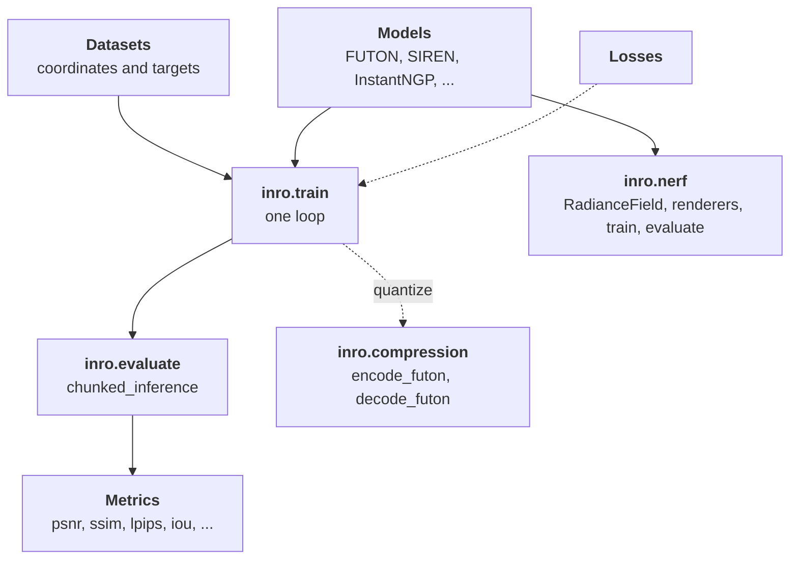

# INRs in Inro

An implicit neural representation (INR) represents a signal as a parametric function of its coordinates, fitted to samples of the signal by minimizing a reconstruction loss.
{ .inro-lead }

$$
\hat{s}_\theta : [-1, 1]^C \to \mathbb{R}^D
$$

<svg class="inro-diagram" viewBox="0 0 476 128" width="560" role="img" aria-label="Coordinates enter an INR, which returns the signal's values there">
  <defs>
    <marker id="inr-arrow" viewBox="0 0 10 10" refX="9" refY="5" markerWidth="7" markerHeight="7" orient="auto"><path d="M0 0L10 5L0 10z" fill="#8a94a6"/></marker>
    <linearGradient id="inr-box" x1="0" y1="0" x2="1" y2="1"><stop offset="0" stop-color="#2c6ad6"/><stop offset="1" stop-color="#15175a"/></linearGradient>
  </defs>
  <g fill="none" stroke="#8a94a6" stroke-width="1">
    <path d="M4 14h80v80h-80z"/><path d="M24 14v80M44 14v80M64 14v80M4 34h80M4 54h80M4 74h80"/>
  </g>
  <rect x="44" y="34" width="20" height="20" fill="#ee6a36"/>
  <text x="44" y="116" font-size="14" text-anchor="middle">a signal</text>
  <path d="M90 54h44" stroke="#8a94a6" stroke-width="1.6" marker-end="url(#inr-arrow)"/>
  <text x="112" y="44" font-size="14" text-anchor="middle">x&#8321;, x&#8322;</text>
  <rect x="140" y="20" width="176" height="68" rx="14" fill="url(#inr-box)"/>
  <text x="228" y="50" font-size="17" font-weight="700" text-anchor="middle" style="fill:#fff">INR</text>
  <text x="228" y="72" font-size="13" text-anchor="middle" style="fill:#ffd98a">FUTON, SIREN, ...</text>
  <path d="M322 54h44" stroke="#8a94a6" stroke-width="1.6" marker-end="url(#inr-arrow)"/>
  <text x="344" y="44" font-size="14" text-anchor="middle">value</text>
  <rect x="376" y="26" width="26" height="56" rx="3" fill="#e0533f"/><rect x="408" y="26" width="26" height="56" rx="3" fill="#57a55a"/><rect x="440" y="26" width="26" height="56" rx="3" fill="#3f73d9"/>
  <text x="421" y="104" font-size="14" text-anchor="middle">R, G, B</text>
</svg>

| Signal | Coordinates | Values |
| --- | --- | --- |
| Image | a pixel, in $[-1, 1]^2$ | $D = 3$, its color |
| Occupancy volume | a voxel, in $[-1, 1]^3$ | $D = 1$, inside or outside |
| Radiance field | a position and a view direction | a density and a color |

Inro keeps this abstraction explicit: models are modules on coordinates, datasets are coordinate/value pairs, and one training loop serves every task that fits samples directly.

<div class="inro-scroll" markdown>



</div>

## Models

Every model maps a tensor of coordinates `(..., in_features)` in $[-1, 1]$ to values `(..., out_features)`, so it can be called on a single point, a batch or a whole grid:

```python
model = inro.FUTON(
    2, 3, basis=("cosine", {"num_components": 64}), combiner=("cp", {"rank": 32}), decoder="linear"
)
model(torch.rand(10, 2) * 2 - 1).shape      # (10, 3)
model(torch.rand(4, 5, 2) * 2 - 1).shape    # (4, 5, 3)
```

The constructors share `in_features`, `out_features` and, where they apply, `hidden_features`, `hidden_layers` and `output_activation`. The [model zoo](models.md) lists them all. The two Deep Image Prior networks are the exception: they map a noise image `(B, channels, H, W)` to an image and are paired with `DIPImageDataset`.

## Datasets

A dataset yields dictionaries with four keys:

| Key | Content |
| --- | --- |
| `id` | A name for the signal, used in logs and file names |
| `input` | Coordinates to evaluate the model at |
| `target` | The values to fit, in the model's output range |
| `_original` | The reference signal in its native form, used by the metrics; keys with a leading underscore stay on the CPU |

`ImageCoordinateDataset`, `OccupancyCoordinateDataset`, `MaskedImageCoordinateDataset`, `SuperResolutionDataset`, `MRICoordinateDataset` and `DIPImageDataset` follow this scheme; the [conventions page](conventions.md) tabulates their shapes.

- **One signal, one item.** `len(dataset) == 1`, and random subsampling happens on access: with `subsample=0.1`, every `dataset[0]` returns a fresh random tenth of the coordinates and their values, flattened.
- **Benchmarks.** The occupancy benchmark trains this way, on $2^{18}$ fresh voxels per step; the image benchmark takes the whole image at every step.
- **Helpers.** `preprocess` maps native values to targets, `postprocess` maps model output back, `save` writes a reconstruction to disk, and `to(device)` moves the training tensors so that subsampling runs on the GPU.

## Training

`inro.train(model, train_dataset, eval_dataset, **options)` fits a model in place.

<ol class="inro-flow">
  <li><strong>Draw a batch</strong>the whole signal or a random subset</li>
  <li><strong>Compute the loss</strong><code>loss_fn(batch, model)</code></li>
  <li><strong>Step</strong>Adam under a cosine schedule</li>
  <li><strong>Log and evaluate</strong>every few steps, off the clock</li>
</ol>

| Part | What it does | Options |
| --- | --- | --- |
| **Optimizer** | Adam. Every benchmark trains every model with PyTorch's defaults, `(0.9, 0.999)` and `1e-8`, so that the optimizer favors none of them | `lr`, `weight_decay`, `adam_betas`, `adam_eps` |
| **Schedule** | Steps of one batch each, with `CosineAnnealingLR` down to `lr / 100` | `num_steps` |
| **Loss** | `loss_fn(batch, model) -> (loss, metrics)`; by default the mean squared error, logging the PSNR for targets in $[-1, 1]$. `inro.rate_distortion_loss`, `inro.sdf_loss` and `inro.super_resolution_loss` have the same signature, and so can [yours](../tutorials/custom-components.md) | `loss_fn` |
| **Evaluation** | `inro.evaluate` reconstructs each item in chunks, maps the output through `postprocess`, and calls each metric as `fn(reconstruction, original)`; rate metrics as `fn(encoded_bytes, original)`, on the parameters serialized with `inro.encode_dict` | `eval_interval`, `metrics`, `rate_metrics`, `chunk_size` |
| **Quantization** | Evaluates a uniformly quantized copy, optionally fake-quantizes during training, and quantizes the final model in place; see the [compression tutorial](../tutorials/compression.md) | `quantize`, `quant_max`, `quant_interval` |
| **Logging** | Records the training metrics of the step's batch, printed above a progress bar, and writes `log.txt`, `log.json`, each evaluation's reconstruction and `checkpoint.pt` | `log_interval`, `log_dir`, `ckpt_path` |

!!! tip "Solvers"

    A FUTON with a CP combiner and a linear decoder, both without bias, can be fitted by block coordinate descent instead of a gradient step: pass `optimizer=inro.LeastSquares(model, momentum=...)` or `inro.MultiplicativeUpdate(model, momentum=...)`. Each batch is swept once, and a sweep costs about the same whole or subsampled, so a whole grid with `momentum=0` is the fast setting. On subsamples, `momentum` averages the blocks' problems over the batches. The newest batch's weight, `1 - momentum`, is the solver's learning rate, and the cosine schedule anneals it as it does Adam's; without momentum it stays one. `optimizer.compile(batch)` compiles the sweep. See the [solvers' reference](../api/futon.md#solvers).

The return value is `{"config", "model_dict", "history"}`: the run's settings, the final parameters, and one record per logged step with `elapsed`, the seconds spent training so far, the training metrics of the step's batch and, when the step was evaluated, the mean evaluation metrics under `"eval"`. The records are plain dictionaries, so `pd.DataFrame(result["history"])` gives a learning curve.

## Evaluation and inference

- `inro.evaluate(model, dataset, metrics=...)` runs the evaluation half of the loop on its own, for example on a checkpoint (`ckpt_path`) or on another grid than the one trained on.
- `inro.chunked_inference(model, coordinates, chunk_size=...)` evaluates a model on any coordinate tensor under `torch.no_grad()`, flattening the leading dimensions for chunking and restoring them afterwards.

## Radiance fields

Novel view synthesis does not fit samples of the signal directly: the supervision is posed images, and the INR is queried along rays. `inro.nerf` therefore has its own dataset (`BlenderDataset`), field (`RadianceField`, which wraps any model from the zoo as its density network), renderers, and `train` and `evaluate` functions with the same shape of return value. The [radiance field tutorial](../tutorials/nerf.md) covers them.
