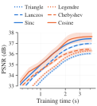
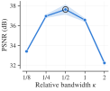
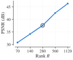
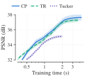
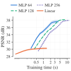

# Ablations

FUTON's design choices, varied one at a time on the image task: the basis, the bandwidth at a fixed size, the rank on either side of that size, the combiner and the head.
{ .inro-lead }

  

    
<a href="#basis">Basis</a>

    
37.6 dB

    
The cosine basis leads, the sinc basis follows at 37.4 dB, and all six families cost the same to train.

  

  

    
<a href="#bandwidth">Bandwidth</a>

    
K = N / 2

    
At a fixed size, halving or doubling it costs 0.7 to 1.1 dB.

  

  

    
<a href="#rank">Rank</a>

    
+3.4 to 5.0 dB

    
Per doubling, from a quarter to four times the benchmark's rank.

  

  

    
<a href="#combiner">Combiner</a>

    
CP leads

    
It beats the tensor ring and Tucker by 0.4 and 2.5 dB; on a grid both train faster, in 3.7 and 2.0 s against 4.2 s.

  

  

    
<a href="#head">Head</a>

    
&minus;7.4 dB

    
The cost of a linear head at equal size; a wider MLP takes two to three times as long.

  

## Protocol

| | |
| --- | --- |
| **Default model** | The benchmark's FUTON: $K = (H/2, W/2)$ components per axis, 384 × 256 for a landscape image, CP rank 280 and a one-layer MLP head 64 wide, 197,379 parameters, trained at 1e-1 |
| **Setting** | The benchmark's: the 24 Kodak images at 768 × 512, 1000 steps, each on the whole image, compiled and timed as the benchmark's on A100s, so only the model changes |
| **Size** | Every model but the rank study's takes the largest rank, a multiple of 5, that keeps FUTON smaller than every baseline (F-INR (SIREN), 198,806 parameters) |
| **Learning rate** | The default's, 1e-1, with three exceptions that each section names: the five families beside the cosine take the sinc basis's rate, 3e-2; two models of the sweeps take 3e-2 because it wins on kodim01 and kodim17, as the benchmark picks its rates; and the Tucker combiner takes 3e-2 because 1e-1 diverges |
| **Tables** | The benchmark's columns: every cost is the median over the images, bold marks the best value in a column and italics the second, and ± is one within-image standard error |
| **Configs** | `configs/ablation-futon/` |

The default model appears in every study. The bandwidth and rank studies reuse the benchmark's runs of it, at 37.63 dB; the other three run it again, so that each stands alone, and land at 37.62 to 37.63 dB, the run-to-run variation of one model and seed.

## Basis

All six families at the default size, so that the parameter count does not depend on the basis: the columns are what each family costs and what it buys. The cosine basis trains at its own rate, 1e-1, and the other five at the sinc basis's, 3e-2, the benchmark's rate for it.

<figure markdown="span">
  
  <figcaption>PSNR against training time for every basis, the band one within-image standard error.</figcaption>
</figure>

- **Orthogonal, global and smooth:** the cosine, Legendre's polynomials and Chebyshev's, the last under a weight.
- **Global and smooth, not orthogonal:** the sinc.
- **Compact support:** the triangle ($C^0$) and Lanczos ($C^1$) kernels.

The benchmark's cosine basis leads at 37.63 dB, ahead on 22 of the 24 images, the sinc follows 0.20 dB behind it, then Lanczos at 36.97 dB and Chebyshev, Legendre and the triangle at 36.0 to 36.4.

| Basis | #Params (k) | Training time (s) ↓ | Training memory (MB) ↓ | Inference throughput (MPix/s) ↑ | Inference memory (MB) ↓ | PSNR (dB) ↑ | SSIM ↑ | LPIPS ↓ |
| --- | --- | --- | --- | --- | --- | --- | --- | --- |
| Cosine | 197.4 | 4.2 | **359** | 230.4 | **201** | **37.63** ± 0.49 | **0.955** ± 0.001 | **0.098** ± 0.002 |
| Chebyshev | 197.4 | **4.1** | **359** | 230.3 | **201** | 36.44 ± 0.16 | 0.939 ± 0.001 | 0.124 ± 0.002 |
| Legendre | 197.4 | 4.2 | 360 | 210.4 | **201** | 36.29 ± 0.12 | 0.937 ± 0.001 | 0.129 ± 0.001 |
| Triangle | 197.4 | **4.1** | **359** | _242.6_ | **201** | 36.03 ± 0.10 | 0.934 ± 0.001 | 0.126 ± 0.001 |
| Lanczos | 197.4 | **4.1** | **359** | 223.4 | **201** | 36.97 ± 0.09 | 0.944 ± 0.001 | 0.112 ± 0.001 |
| Sinc | 197.4 | **4.1** | **359** | **248.4** | **201** | _37.43_ ± 0.09 | _0.949_ ± 0.001 | _0.108_ ± 0.001 |

- **Accuracy.** Among the orthogonal families the cosine leads the two polynomial ones by 1.2 and 1.3 dB, and among the kernels Lanczos's smoother lobes beat the triangle's kinks by 0.9 dB, on every image.
- **Cost.** Training costs the same for every family, 4.1 to 4.2 s and 359 to 360 MB: each basis is tabulated on the pixel grid (`grid_size = (H, W)`), so a step contracts tables of the same shape whatever the family, and the compact support of the triangle and Lanczos saves nothing there. Evaluation runs at 210 to 248 megapixels per second, within the spread of the default model from one study to the next, 204 to 249.
- **Other metrics.** SSIM and LPIPS order the bases as PSNR does, but for the triangle and Legendre, 0.26 dB apart, which LPIPS swaps.

## Bandwidth

The relative bandwidth $\kappa = K / N$, the components per axis as a fraction of the pixels, over {1/8, 1/4, 1/2, 1, 2}, at the budget. A rank costs a factor entry per component on each axis and a weight per hidden unit, $(K_1 + K_2 + 64) R + 259$ parameters in all, so the rank falls as the bandwidth grows: 885, 515, 280, 145 and 75. At $\kappa = 1$ each axis has as many components as pixels, the grid's Nyquist rate, and $\kappa = 1/2$ is the benchmark's FUTON. The model at $\kappa = 1/8$ trains at 3e-2, since at 1e-1 it loses 1.4 dB on kodim01 and kodim17.

<figure markdown="span">
  
  <figcaption>PSNR against the relative bandwidth at the budget, the band one within-image standard error; the ring marks the benchmark's model.</figcaption>
</figure>

Half the resolution is best, at 37.63 dB, ahead of each other bandwidth on 23 of the 24 images, and the PSNR falls on either side: by 0.67 dB at $\kappa = 1/4$ and 1.07 dB at $\kappa = 1$, and by 4.2 and 5.4 dB at 1/8 and 2.

- **Below $\kappa = 1/2$** the rank grows but the basis is coarser than the image's detail, which the MLP's nonlinearity only partly makes up: at $\kappa = 1/8$ the cosines alone cap a linear FUTON at 23.65 dB on average, the truncation on the [error bound](../concepts/error-bound.md) page, and the MLP reaches 33.41.
- **Above it** the rank shrinks, and past $\kappa = 1$ the extra components add no function the pixel grid can tell apart, so $\kappa = 2$ pays twice the factor entries for the span of $\kappa = 1$.

| κ | R | #Params (k) | Training time (s) ↓ | Training memory (MB) ↓ | Inference throughput (MPix/s) ↑ | Inference memory (MB) ↓ | PSNR (dB) ↑ | SSIM ↑ | LPIPS ↓ |
| --- | --- | --- | --- | --- | --- | --- | --- | --- | --- |
| 1/8 | 885 | 198.5 | 9.0 | 442 | 111.9 | 219 | 33.41 ± 0.15 | 0.914 ± 0.003 | 0.167 ± 0.004 |
| 1/4 | 515 | 198.0 | 6.1 | 392 | 156.9 | **201** | _36.95_ ± 0.18 | _0.948_ ± 0.003 | _0.118_ ± 0.004 |
| 1/2 | 280 | 197.4 | 4.1 | 359 | 228.7 | **201** | **37.63** ± 0.51 | **0.955** ± 0.003 | **0.098** ± 0.003 |
| 1 | 145 | 195.1 | _2.8_ | _341_ | _254.1_ | **201** | 36.56 ± 0.19 | 0.936 ± 0.002 | 0.140 ± 0.003 |
| 2 | 75 | 197.1 | **2.2** | **331** | **335.5** | **201** | 32.26 ± 0.26 | 0.860 ± 0.007 | 0.271 ± 0.008 |

The costs run the other way, since the rank sets them: at $\kappa = 1/8$ FUTON trains 2.2 times slower than at 1/2, at 1.2 times the memory, and at $\kappa = 2$ in half the time, for 5.4 dB less. SSIM and LPIPS agree with the PSNR's order.

## Rank

The CP rank over {70, 140, 280, 560, 1120} at the benchmark's bandwidth, $\kappa = 1/2$, on either side of the budget: the size doubles with the rank, from 49,539 to 788,739 parameters, a quarter to four times the benchmark's. Rank 1120 trains at 3e-2, since at 1e-1 it loses 4.6 dB on kodim01 and kodim17.

<figure markdown="span">
  
  <figcaption markdown="span">PSNR against the CP rank at $\kappa = 1/2$, the band one within-image standard error; the ring marks the benchmark's model.</figcaption>
</figure>

Rank keeps paying. Each doubling adds 3.4 to 5.0 dB, the last, to rank 1120, still 3.8: there FUTON holds 788,739 parameters, two thirds of the image's 1,179,648 values, and reaches 46.33 dB, still 12.6 dB below the 58.9 dB of the images' 8-bit quantization.

In the benchmark, the budget rather than the model holds FUTON near 38 dB.

| R | #Params (k) | Training time (s) ↓ | Training memory (MB) ↓ | Inference throughput (MPix/s) ↑ | Inference memory (MB) ↓ | PSNR (dB) ↑ | SSIM ↑ | LPIPS ↓ |
| --- | --- | --- | --- | --- | --- | --- | --- | --- |
| 70 | 49.5 | **2.2** | **330** | **305.8** | **201** | 30.81 ± 0.28 | 0.826 ± 0.010 | 0.304 ± 0.008 |
| 140 | 98.8 | _2.7_ | _340_ | _249.8_ | **201** | 34.20 ± 0.29 | 0.903 ± 0.003 | 0.190 ± 0.004 |
| 280 | 197.4 | 4.1 | 359 | 228.7 | **201** | 37.63 ± 0.46 | 0.955 ± 0.003 | 0.098 ± 0.003 |
| 560 | 394.5 | 6.2 | 398 | 152.0 | **201** | _42.58_ ± 0.20 | _0.983_ ± 0.005 | _0.040_ ± 0.004 |
| 1120 | 788.7 | 10.9 | 473 | 95.2 | 251 | **46.33** ± 0.30 | **0.992** ± 0.005 | **0.016** ± 0.005 |

The costs grow slower than the rank: from 280 to 1120, training takes 2.6 times as long at 1.3 times the memory, and evaluation runs 2.4 times slower. Below the benchmark's rank the fixed costs show, and halving the rank saves only a third of the training time.

## Combiner

Tensor-ring and Tucker combiners against the CP one, at the default $K$, each at the largest rank within the budget.

- **Tensor ring.** A ring of rank $r$ feeds the head $r^2$ features and grows with them: rank 16 holds 180,483 parameters, and rank 17 would hold 203,715. It trains at the default's rate, 1e-1.
- **Tucker.** It takes a rank per axis in proportion to its components, $R_c = \gamma K_c$ with $\gamma = 0.163$: on a 512 × 768 image it projects the axes to 41 and 62 directions and contracts them with a $41 \times 62 \times 62$ core whose 62 features feed the head, 196,135 parameters. It trains at 3e-2, since at 1e-1 it diverges on 8 of the 24 images.

<figure markdown="span">
  
  <figcaption>PSNR against training time for every combiner, the band one within-image standard error.</figcaption>
</figure>

CP is the most accurate, ahead of both on 23 of the 24 images, but on a grid no longer the cheapest: each combiner reads the whole image off one contraction, which costs the more the wider the bonds it sums over, CP's 280 ranks, the ring's $16 \times 16$ or Tucker's 62.

- **Against the ring** it gains 0.36 dB, in 1.1 times the ring's training time and the same memory.
- **Against Tucker** it gains 2.51 dB, in twice Tucker's training time: the core holds 157,604 of Tucker's parameters, while each axis passes through only 41 or 62 directions against CP's 280.

| Combiner | #Params (k) | Training time (s) ↓ | Training memory (MB) ↓ | Inference throughput (MPix/s) ↑ | Inference memory (MB) ↓ | PSNR (dB) ↑ | SSIM ↑ | LPIPS ↓ |
| --- | --- | --- | --- | --- | --- | --- | --- | --- |
| CP | 197.4 | 4.2 | 359 | 203.5 | **201** | **37.62** ± 0.41 | **0.955** ± 0.001 | **0.098** ± 0.002 |
| TR | 180.5 | _3.7_ | _356_ | _216.9_ | **201** | _37.26_ ± 0.27 | _0.947_ ± 0.001 | _0.112_ ± 0.002 |
| Tucker | 196.1 | **2.0** | **330** | **325.3** | **201** | 35.12 ± 0.16 | 0.915 ± 0.002 | 0.170 ± 0.003 |

## Head

With a linear head FUTON is exactly a rank-$R$ CP model of the signal's coefficients in its basis, the model the theory treats; the benchmark on images uses a one-layer MLP 64 wide. Wider MLPs and the linear head are compared at equal size, each at the largest rank within the budget: 255 behind a hidden layer of 128 units, 220 behind 256, and 305 for the linear map, which frees the MLP's 18k parameters. All four keep the tanh on the output and the default's rate, 1e-1.

<figure markdown="span">
  
  <figcaption>PSNR against training time for every head, the band one within-image standard error.</figcaption>
</figure>

- **Width buys little at this size:** the 128- and 256-wide MLPs give up rank for it and end 0.54 and 0.33 dB above the 64-wide one on average, but above it on only 12 and 6 of the 24 images, in 1.9 and 2.8 times its training time and 2.9 and 3.3 times its memory.
- **A natural image is far from a low-rank tensor in a smooth basis:** at equal size the linear head stops at 30.26 dB, 7.4 dB below the MLP, though it trains fastest, in a third of the MLP's time.

The MLP head 64 wide is the default on images, the cheapest of the three widths, and the linear head remains the model to reason about: without its bias and tanh, it is the model the [error bound](../concepts/error-bound.md) covers. Occupancy volumes differ: on grids of 256 voxels per unit length the linear head tied the best MLP at equal size, in a seventh of its training time, so the volumes' benchmark uses it.

| Head | #Params (k) | Training time (s) ↓ | Training memory (MB) ↓ | Inference throughput (MPix/s) ↑ | Inference memory (MB) ↓ | PSNR (dB) ↑ | SSIM ↑ | LPIPS ↓ |
| --- | --- | --- | --- | --- | --- | --- | --- | --- |
| MLP, 64 wide (R = 280) | 197.4 | _4.2_ | _359_ | _248.6_ | _201_ | 37.62 ± 0.49 | **0.955** ± 0.002 | **0.098** ± 0.003 |
| MLP, 128 wide (R = 255) | 196.4 | 8.1 | 1024 | 131.7 | 602 | **38.16** ± 0.15 | _0.954_ ± 0.002 | _0.099_ ± 0.001 |
| MLP, 256 wide (R = 220) | 198.1 | 12.0 | 1176 | 90.4 | 749 | _37.95_ ± 0.17 | 0.951 ± 0.002 | 0.106 ± 0.002 |
| Linear (R = 305) | 196.1 | **1.4** | **37** | **346.1** | **19** | 30.26 ± 0.27 | 0.874 ± 0.006 | 0.201 ± 0.005 |
