# Benchmarks

Thirteen models on three tasks, at equal parameter count per task.
{ .inro-lead }

  

    
Images, Kodak

    
+0.90 dB

    
FUTON, 37.63 dB, against MFN's 36.72, in 4.1 s against 57.3 s.

  

  

    
Occupancy, Stanford

    
+0.06 %

    
FUTON, 99.97 % IoU, against RFF's 99.91 %, in 1.7 s against 11.7 s.

  

  

    
Radiance fields, Blender

    
+0.60 dB

    
FUTON, 29.22 dB, against FINER's 28.62, in 152 s against 219 s.

  

## Reading the numbers

=== "Accuracy"

    - **Images.** FUTON leads PSNR, SSIM and LPIPS, by 0.90 dB over MFN, the strongest baseline, and is ahead of every baseline on 21 of the 24 images.
    - **Volumes.** It has the best mean IoU, 99.97 % against 99.91 % for RFF, and the best IoU on four of the five shapes; on the armadillo RFF leads, 99.97 % against 99.95 %. It passes 99.8 % on every shape after 0.8 s of training, where GA-Planes, the only other model to get there, takes 11.4 s.
    - **Radiance fields.** It leads FINER by 0.60 dB and five of the eight scenes.

=== "Training speed"

    - **The fastest.** FUTON is the fastest model to train on volumes, 1.7 s against Instant-NGP's 2.6 s. Instant-NGP is the fastest on the other two tasks: 3.6 s against FUTON's 4.1 s on images and 147 s against 152 s on radiance fields.
    - **FUTON's place.** It follows Instant-NGP on images and radiance fields.
    - **Memory.** FUTON's training memory is the lowest on every task: 0.36 GB on images, 0.11 GB on volumes and 1.88 GB on radiance fields.
    - **Implementations.** The hash grid is a PyTorch port of tiny-cuda-nn's, without the fused CUDA kernels, gathering every level in one batched pass; FUTON is plain PyTorch, and every model is compiled.

=== "Inference"

    - **Images and volumes.** FUTON is the fastest on both: 229 megapixels per second against Instant-NGP's 198 on images, and 462 megavoxels per second against TensoRF's 191 on volumes.
    - **Radiance fields.** A radiance field renders a whole view in one pass in 20 to 30 ms, 34 to 50 frames per second, and FUTON is the fastest, at 49.6 against 47.2 for TensoRF, 45.7 for GA-Planes and 44.0 for Instant-NGP.
    - **Memory.** FUTON infers in the least memory on images and volumes, 0.20 GB and 86 MB, and renders a radiance field in the least, 2.04 GB, which TensoRF and GA-Planes match: nearly all of that is the ray marcher's buffers for the view's 40,000 rays.

## How to read the tables

The tables come from the runs' `results.json`, and the figures are the paper's.

- **Marks.** Bold marks the best value in a column and italics the second.
- **Errors.** ± is one standard error over the signals, after removing each signal's own level (a paired standard error). IoU, which saturates near 100 % on every shape, takes the plain standard error over the shapes.
- **Costs.** Accuracy and costs come from the same runs. Every model is compiled with `torch.compile` and trained on an A100 after an untimed warm-up pass that compiles it. The training time counts the training steps alone; inference throughput and memory are the medians over a run's evaluations, for a radiance field over its 200 test views, each rendered whole in one pass, and training memory is the run's peak. Each cost in the tables and figures is the median over a task's signals.

??? note "Notes on the rows"

    - A name in parentheses is the variant a row runs where its kind has several: the backbone of F-INR and FreSh. FUTON runs its default basis, the cosine; the [basis ablation](ablations.md#basis) compares it with five others.
    - **TensoRF** is the variant its authors recommend for the dimension: CP on images (the only one in 2D) and VM on volumes and radiance fields; both are in the configs.
    - **MFN** is the GaborNet of the two networks of its paper, and **WIRE** the real Gabor variant (`inro.RealWIRE`) from the WIRE paper and code.
    - **F-INR (SIREN)** gives each coordinate its own SIREN, built and initialized as in its authors' image code, and combines them per channel by a CP decomposition. Their settings do not fit the budget, so we tuned at equal size what they leave open: the split between width and rank (in 2D the most rank a width allows, one more than the width; width 96 and rank 259 on volumes, width 32 and rank 39 on radiance fields), the first layer's frequency (200 on images, above their 100, and 100 elsewhere) and the decomposition, CP rather than the tensor train they pick for shapes and radiance fields. Neither the positional encoding of their image experiments nor the SIREN of their shape code helps at this size. Their paper fits radiance fields with per-axis hash grids; here the axes are SIRENs on every task.
    - **FreSh (SIREN)** is the SIREN row with its first-layer frequency chosen per signal before training, by matching the spectrum of the untrained network's output to the signal's, and the search counts toward its training time. Its paper covers images and radiance fields; on volumes it reads the 3D spectrum of the occupancy grid, our adaptation.

## Images

24 Kodak images at 768 × 512, about 197k parameters per model, 1000 steps, each on the whole image, scored on every pixel.

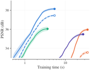

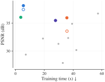

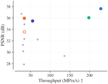

--8<-- "docs/_overrides/snippets/legend.html"

PSNR against training time for FUTON and the strongest model of each family, the band one within-image standard error; every model's final PSNR against its training time; and against its inference throughput.

| Model | #Params (k) | Training time (s) ↓ | Training memory (GB) ↓ | Inference throughput (MPix/s) ↑ | Inference memory (GB) ↓ | PSNR (dB) ↑ | SSIM ↑ | LPIPS ↓ |
| --- | --- | --- | --- | --- | --- | --- | --- | --- |
| RFF | 199.7 | 29.8 | 2.08 | 30.7 | 1.21 | 31.28 ± 0.17 | 0.846 ± 0.007 | 0.271 ± 0.007 |
| PE-MLP | 209.2 | 32.8 | 2.11 | 33.2 | 0.81 | 27.86 ± 0.16 | 0.726 ± 0.015 | 0.431 ± 0.008 |
| MFN | 204.3 | 57.3 | 7.67 | 26.8 | 3.22 | _36.72_ ± 0.17 | _0.938_ ± 0.003 | 0.129 ± 0.003 |
| SIREN | 198.9 | 35.7 | 3.25 | 34.4 | 0.81 | 33.57 ± 0.15 | 0.906 ± 0.003 | 0.192 ± 0.004 |
| FreSh (SIREN) | 198.9 | 39.3 | 3.25 | 34.5 | 0.81 | 34.88 ± 0.15 | 0.922 ± 0.003 | 0.150 ± 0.003 |
| Gauss | 198.9 | 36.6 | 3.64 | 34.3 | 0.81 | 32.33 ± 0.19 | 0.877 ± 0.005 | 0.213 ± 0.004 |
| WIRE | 199.3 | 42.2 | 4.00 | 31.5 | 0.86 | 30.17 ± 0.46 | 0.807 ± 0.017 | 0.260 ± 0.010 |
| FINER | 198.9 | 35.7 | 3.25 | 34.3 | 0.81 | 35.96 ± 0.14 | _0.938_ ± 0.003 | _0.120_ ± 0.002 |
| Instant-NGP | 205.1 | **3.6** | _0.72_ | _198.3_ | _0.50_ | 36.05 ± 0.20 | 0.932 ± 0.002 | 0.142 ± 0.004 |
| TensoRF | 202.0 | 27.8 | 1.79 | 55.2 | 0.81 | 35.48 ± 0.13 | 0.920 ± 0.002 | 0.161 ± 0.003 |
| GA-Planes | 199.9 | 19.0 | 1.32 | 68.1 | 0.81 | 32.23 ± 0.20 | 0.878 ± 0.004 | 0.227 ± 0.005 |
| F-INR (SIREN) | 198.8 | 7.1 | 2.70 | 136.3 | 1.34 | 29.35 ± 0.13 | 0.786 ± 0.007 | 0.343 ± 0.005 |
| FUTON | 197.4 | _4.1_ | **0.36** | **228.7** | **0.20** | **37.63** ± 0.55 | **0.955** ± 0.004 | **0.098** ± 0.004 |

<figure markdown="span">
  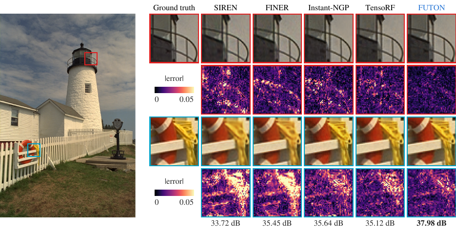
  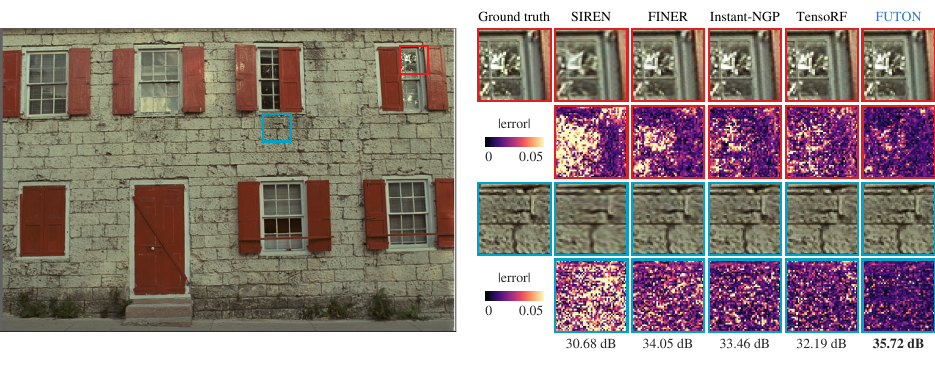
  <figcaption>kodim19 and kodim01: two regions of fine detail magnified for the ground truth and every featured model, above each model's |error| there on one scale per figure, with each model's PSNR over the whole image.</figcaption>
</figure>

## Occupancy

Five Stanford shapes voxelized at 256 samples per unit length and cropped to their bounds (2.1 to 7.9 million voxels, the longest side 231), about 131k parameters per model, 1000 steps, each on $2^{18}$ random voxels, scored by IoU on every voxel.

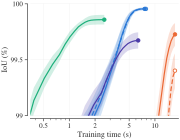

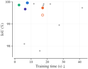

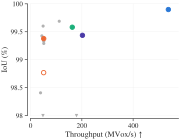

--8<-- "docs/_overrides/snippets/legend.html"

IoU against training time for the featured models; every model's final IoU against its training time; and against its inference throughput, in megavoxels per second.

| Model | #Params (k) | Training time (s) ↓ | Training memory (GB) ↓ | Inference throughput (MVox/s) ↑ | Inference memory (MB) ↓ | IoU (%) Armadillo ↑ | IoU (%) Dragon ↑ | IoU (%) Happy Buddha ↑ | IoU (%) Lucy ↑ | IoU (%) Thai Statue ↑ | IoU (%) Mean ↑ |
| --- | --- | --- | --- | --- | --- | --- | --- | --- | --- | --- | --- |
| RFF | 132.2 | 11.7 | 1.04 | 48.2 | 819 | **99.97** | _99.97_ | 99.91 | 99.79 | _99.93_ | _99.91_ ± 0.03 |
| PE-MLP | 132.3 | 15.4 | 1.02 | 48.2 | 520 | 98.30 | 98.27 | 98.86 | 95.46 | 98.01 | 97.78 ± 0.60 |
| MFN | 138.0 | 27.4 | 3.77 | 38.3 | 1359 | 99.47 | 98.52 | 98.49 | 98.98 | 99.27 | 98.95 ± 0.20 |
| SIREN | 132.9 | 17.1 | 1.62 | 50.6 | 551 | 99.02 | 99.60 | 99.85 | 99.45 | 99.09 | 99.40 ± 0.16 |
| FreSh (SIREN) | 132.9 | 41.6 | 1.62 | 50.4 | 551 | 99.54 | 99.83 | _99.97_ | 99.75 | 99.56 | 99.73 ± 0.08 |
| Gauss | 132.9 | 17.5 | 1.62 | 50.8 | 551 | 99.69 | 99.95 | 99.94 | 99.87 | 99.72 | 99.83 ± 0.05 |
| WIRE | 133.4 | 21.9 | 1.91 | 46.6 | 583 | 99.78 | 99.96 | _99.97_ | _99.93_ | 99.88 | 99.90 ± 0.03 |
| FINER | 132.9 | 17.2 | 1.62 | 50.5 | 551 | 99.43 | 99.81 | _99.97_ | 99.87 | 99.54 | 99.73 ± 0.10 |
| Instant-NGP | 133.2 | _2.6_ | 0.53 | 158.0 | 718 | _99.96_ | 99.96 | 99.78 | 99.80 | 99.78 | 99.86 ± 0.04 |
| TensoRF | 132.4 | 6.4 | _0.44_ | _191.1_ | _282_ | 99.86 | 99.77 | 99.74 | 99.50 | 99.50 | 99.67 ± 0.07 |
| GA-Planes | 132.0 | 17.8 | 0.58 | 105.8 | 328 | 99.88 | 99.95 | 99.94 | 99.90 | 99.85 | 99.90 ± 0.02 |
| F-INR (SIREN) | 131.8 | 5.9 | 1.65 | 119.9 | 835 | 98.05 | 98.53 | 98.74 | 97.42 | 97.73 | 98.09 ± 0.24 |
| FUTON | 130.9 | **1.7** | **0.11** | **462.2** | **86** | 99.95 | **99.99** | **99.99** | **99.99** | **99.94** | **99.97** ± 0.01 |

<figure markdown="span">
  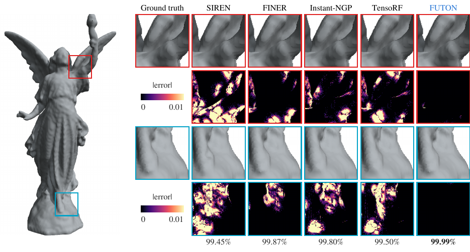
  <figcaption>Lucy, reconstructed from each model's checkpoint by marching cubes and rendered offscreen: the shoulder under the torch and the hem magnified for the ground truth and every featured model, above each model's |error| there on one scale, with each model's IoU over the whole volume.</figcaption>
</figure>

## Radiance fields

Eight NeRF synthetic (Blender) scenes under FINER's protocol: 200 × 200 views, 25 training views, 25,000 steps of 4096 rays (FINER's protocol trains for 37,500), scored on all 200 test views. Every model is the density network of the same radiance field (15 geometry features, spherical-harmonics direction encoding, a 64 × 2 color MLP), about 75k parameters in all.

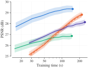

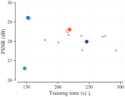

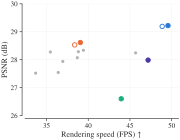

--8<-- "docs/_overrides/snippets/legend.html"

Validation PSNR against training time for the featured models; every model's final test PSNR against its training time; and against its rendering speed, in frames per second.

| Model | #Params (k) | Training time (s) ↓ | Training memory (GB) ↓ | Inference FPS ↑ | Inference memory (GB) ↓ | PSNR (dB) ↑ | SSIM ↑ | LPIPS ↓ |
| --- | --- | --- | --- | --- | --- | --- | --- | --- |
| RFF | 74.5 | 179.3 | 2.91 | 38.7 | 2.12 | 28.07 ± 0.30 | 0.928 ± 0.004 | 0.082 ± 0.008 |
| PE-MLP | 75.1 | 201.0 | 3.00 | 37.0 | 2.10 | 27.94 ± 0.22 | 0.931 ± 0.003 | 0.079 ± 0.006 |
| MFN | 75.8 | 275.6 | 9.97 | 35.5 | 3.61 | 28.28 ± 0.16 | 0.932 ± 0.002 | 0.078 ± 0.006 |
| SIREN | 75.2 | 215.5 | 5.08 | 38.4 | 2.14 | 28.53 ± 0.16 | 0.935 ± 0.002 | 0.106 ± 0.007 |
| FreSh (SIREN) | 75.2 | 217.2 | 5.03 | 39.4 | 2.13 | 28.34 ± 0.23 | 0.928 ± 0.004 | 0.146 ± 0.016 |
| Gauss | 75.2 | 239.1 | 4.82 | 36.4 | 2.18 | 27.54 ± 0.21 | 0.922 ± 0.003 | 0.105 ± 0.008 |
| WIRE | 74.5 | 237.9 | 4.97 | 38.8 | 2.19 | 28.29 ± 0.19 | 0.928 ± 0.003 | 0.126 ± 0.007 |
| FINER | 75.2 | 218.8 | 5.02 | 39.1 | 2.15 | _28.62_ ± 0.19 | 0.934 ± 0.002 | 0.120 ± 0.009 |
| Instant-NGP | 75.0 | **147.0** | 2.80 | 44.0 | 3.26 | 26.60 ± 0.37 | 0.908 ± 0.009 | 0.119 ± 0.011 |
| TensoRF | 74.8 | 246.2 | 2.14 | _47.2_ | **2.04** | 27.99 ± 0.18 | 0.931 ± 0.003 | 0.076 ± 0.007 |
| GA-Planes | 75.0 | 271.6 | _2.10_ | 45.7 | **2.04** | 28.24 ± 0.19 | _0.936_ ± 0.003 | _0.071_ ± 0.005 |
| F-INR (SIREN) | 74.7 | 292.8 | 16.18 | 33.7 | 6.69 | 27.52 ± 0.47 | 0.911 ± 0.012 | 0.127 ± 0.020 |
| FUTON | 73.0 | _152.0_ | **1.88** | **49.6** | **2.04** | **29.22** ± 0.24 | **0.943** ± 0.004 | **0.065** ± 0.007 |

Per scene, FUTON leads five of the eight: chair, hotdog, lego, materials and ship; FINER leads drums, ficus, by 0.04 dB, and mic.

??? note "Test-view PSNR per scene, in dB"

    | Model | Chair | Drums | Ficus | Hotdog | Lego | Materials | Mic | Ship |
    | --- | --- | --- | --- | --- | --- | --- | --- | --- |
    | RFF | _33.10_ | 22.91 | 27.47 | 32.76 | 28.48 | 25.62 | 33.37 | 20.88 |
    | PE-MLP | 32.09 | 22.84 | 25.75 | 32.06 | 28.55 | 26.64 | 32.44 | _23.12_ |
    | MFN | 32.94 | 23.77 | 27.28 | 32.56 | 28.52 | 25.60 | 33.04 | 22.50 |
    | SIREN | 32.54 | _24.58_ | 27.61 | 32.40 | 29.03 | 26.53 | 33.25 | 22.29 |
    | FreSh (SIREN) | 32.38 | 24.19 | 27.60 | 32.81 | 29.62 | 25.18 | 32.58 | 22.32 |
    | Gauss | 30.92 | 23.69 | 26.41 | 32.07 | 27.66 | 25.21 | 32.46 | 21.94 |
    | WIRE | 32.63 | 24.18 | 27.54 | 32.00 | 28.44 | 26.14 | 33.23 | 22.13 |
    | FINER | 32.85 | **24.61** | **27.74** | 32.30 | 29.46 | 26.11 | **33.58** | 22.27 |
    | Instant-NGP | 31.35 | 23.03 | 22.64 | 30.87 | 27.29 | 24.57 | 31.92 | 21.16 |
    | TensoRF | 31.60 | 23.70 | 25.74 | 32.73 | 28.60 | 26.31 | 32.43 | 22.78 |
    | GA-Planes | 32.58 | 23.75 | 25.77 | _33.06_ | _29.63_ | 26.09 | 32.29 | 22.79 |
    | F-INR (SIREN) | 32.81 | 21.42 | 24.23 | 32.39 | 29.22 | _27.37_ | 31.78 | 20.93 |
    | FUTON | **33.18** | 23.86 | _27.70_ | **33.20** | **31.28** | **27.65** | _33.40_ | **23.48** |

<figure markdown="span">
  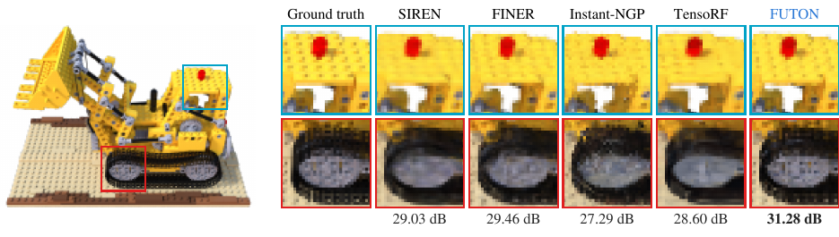
  <figcaption>The lego scene from a test view, with two regions magnified.</figcaption>
</figure>

<figure markdown="span">
  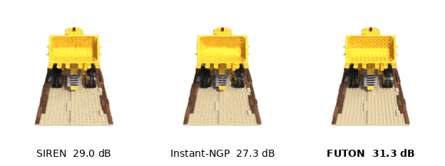{ width="720" }
  <figcaption>The same scene in orbit: SIREN, Instant-NGP and FUTON, with their test-view PSNR.</figcaption>
</figure>

## Checks against the literature

Where the protocol meets a published one, the numbers agree, allowing for the shorter radiance-field schedule.

- **Radiance fields.** The protocol is FINER's, which trains for 37,500 steps; at our 25,000 and our 75k budget, SIREN lands 0.3 dB and FINER 0.6 dB below that paper's table on average, by at most 1.1 dB on a scene, and our PE-MLP and WIRE are stronger than its.
- **Hash grid.** Its low radiance-field score is what a 75k budget leaves it: its tables hold $2^{11}$ entries per level, 256 times fewer than in its paper.

The [ablations](ablations.md) take FUTON apart, and [Reproducing the paper](reproduce.md) has the commands that produced every number above.
