**Inro** is a PyTorch package for implicit neural representations (INRs): a unified framework for implementing, training and evaluating them. It features the official implementation of **FUTON**, introduced in [our paper](https://arxiv.org/abs/2602.13414), and major INR architectures such as SIREN, FINER, RFF, Instant-NGP and TensoRF behind one interface. Reusable components and pipelines cover image and volume representation and novel view synthesis.

## FUTON against the strongest baseline

Every model of a task has the same parameter budget, and times are median training times per signal on an A100, from the same runs as the scores. FUTON makes the best trade-off of speed and reconstruction quality on every task.

<div class="inro-tiles">
  <div class="inro-tile">
    <p class="inro-tile__task">Images, Kodak</p>
    <p class="inro-tile__gain">+0.90 dB</p>
    <p class="inro-tile__note">37.63 dB against MFN's 36.72, in 4.1 s against 57.3 s.</p>
  </div>
  <div class="inro-tile">
    <p class="inro-tile__task">Occupancy, Stanford</p>
    <p class="inro-tile__gain">+0.06 %</p>
    <p class="inro-tile__note">99.97 % IoU against RFF's 99.91 %, in 1.7 s against 11.7 s.</p>
  </div>
  <div class="inro-tile">
    <p class="inro-tile__task">Radiance fields, Blender</p>
    <p class="inro-tile__gain">+0.60 dB</p>
    <p class="inro-tile__note">29.22 dB against FINER's 28.62, in 152 s against 219 s.</p>
  </div>
</div>

## How FUTON works

Most INRs hide their prior in the nonlinearity: sines, Gabor wavelets, Gaussians, or a hash-grid lookup in front of a ReLU network. FUTON puts the prior in the parameterization: the signal is expanded in a fixed basis along each coordinate axis, and the coefficient tensor of that expansion is stored in low-rank form.

<figure markdown="span">
  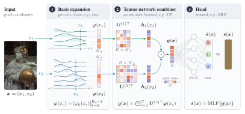{ width="960" }
</figure>

<div class="grid cards" markdown>

-   :material-sine-wave:{ .lg .middle } **Fast**

    ---

    A point costs $O(CKR)$ for $C$ axes, $K$ basis functions per axis and rank $R$. On a grid, each axis is evaluated once per distinct coordinate and shared by every point on it.

-   :material-target:{ .lg .middle } **Accurate at equal size**

    ---

    At matched parameter counts FUTON leads every baseline on the average of Kodak images, Stanford occupancy volumes and Blender radiance fields.

-   :material-eye-outline:{ .lg .middle } **Transparent**

    ---

    With a linear head FUTON *is* a rank-$R$ CP model of the signal in the chosen basis, so bandwidth ($K$) and capacity ($R$) are explicit knobs, with a [computable error bound](concepts/error-bound.md).

</div>

## See the difference

<div class="inro-panels inro-panels--two">
<figure class="inro-showcase">
  <div class="inro-compare" data-compare>
    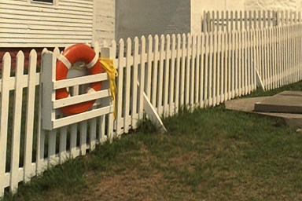
    <div class="inro-compare__after"></div>
    <div class="inro-compare__divider"></div>
    <span class="inro-compare__label inro-compare__label--left">SIREN, 33.72 dB</span>
    <span class="inro-compare__label inro-compare__label--right">FUTON, 37.93 dB</span>
    <input type="range" min="0" max="100" value="50" aria-label="Move to compare SIREN with FUTON">
  </div>
  <figcaption>Drag across a crop of kodim19. Both models hold about 197k parameters, and each score is over the whole image.</figcaption>
</figure>
<figure class="inro-showcase">
  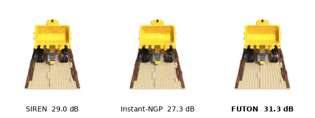
  <figcaption>The lego scene in orbit, at about 75k parameters per model, with the test-view PSNR.</figcaption>
</figure>
</div>

## Results

=== "Images"

    <div class="inro-panels" markdown>

    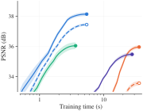

    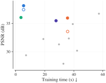

    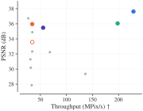

    </div>

    --8<-- "docs/_overrides/snippets/legend.html"

    <figure markdown="span">
      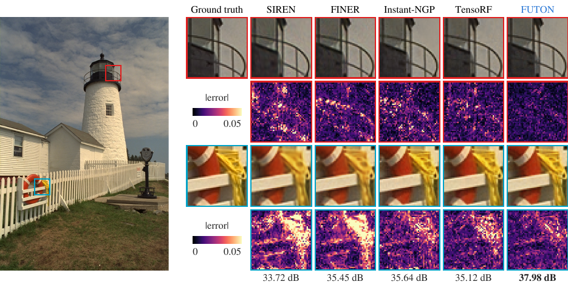
    </figure>

=== "Occupancy"

    <div class="inro-panels" markdown>

    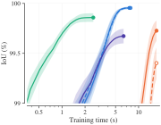

    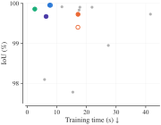

    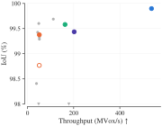

    </div>

    --8<-- "docs/_overrides/snippets/legend.html"

    <figure markdown="span">
      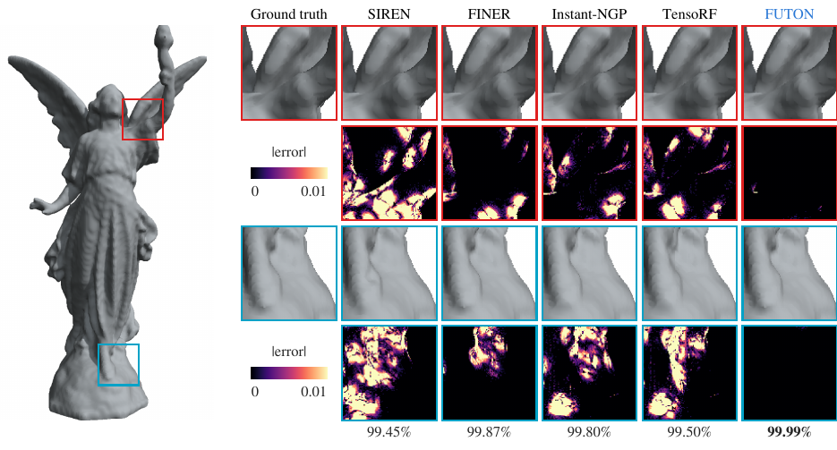
    </figure>

=== "Radiance fields"

    <div class="inro-panels" markdown>

    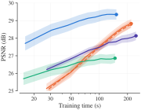

    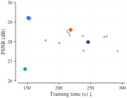

    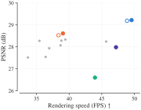

    </div>

    --8<-- "docs/_overrides/snippets/legend.html"

    <figure markdown="span">
      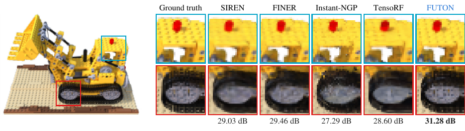
    </figure>

<p class="inro-caption">Quality against training time for FUTON and the strongest model of each family, with bands of one standard error; every model's final quality against its training time; and against its inference speed. <a href="experiments/benchmarks/">The benchmarks page</a> has every model, metric and error bar.</p>

## One interface

Every model maps coordinates in $[-1, 1]$ to values, so one training call fits them all.

```python
import torch
import inro

dataset = inro.ImageCoordinateDataset("data/Kodak/kodim19.png")  # (1)!
H, W, _ = dataset.target.shape

model = inro.FUTON(  # (2)!
    in_features=2,
    out_features=3,
    basis=("cosine", {"num_components": [H // 2, W // 2]}),
    combiner=("cp", {"rank": 280}),
    head=("mlp", {"hidden_layers": 1, "hidden_features": 64}),  # (3)!
    output_activation=torch.tanh,
)

result = inro.train(model, dataset, dataset, num_steps=1000, lr=1e-1, metrics={"psnr": inro.psnr})
print(result["history"][-1]["eval"])  # {"psnr": 37.8}
```

1.  Any RGB image: a path, a tensor or a PIL image. Each access returns every pixel's coordinates and color.
2.  Swap in any other model of the zoo, such as `inro.SIREN(2, 3, hidden_features=256, hidden_layers=4, output_activation=torch.tanh)`. The training call stays the same.
3.  An MLP with one hidden layer 64 wide, whose first layer reads a whole image off the combiner's grid in one contraction.

## Explore

<div class="grid cards" markdown>

-   :material-rocket-launch-outline:{ .lg .middle } **[Getting started](getting-started/index.md)**

    ---

    Install the package and fit your first INR in a dozen lines.

-   :material-book-open-variant-outline:{ .lg .middle } **[Concepts](concepts/index.md)**

    ---

    How models, datasets and the training loop fit together, FUTON stage by stage, and its error bound.

-   :material-school-outline:{ .lg .middle } **[Tutorials](tutorials/index.md)**

    ---

    Images, occupancy volumes and radiance fields, and notebooks that run each end to end.

-   :material-chart-line:{ .lg .middle } **[Experiments](experiments/index.md)**

    ---

    The benchmark protocol, every table and figure, the ablations, and how to reproduce them.

-   :material-code-braces:{ .lg .middle } **[API reference](api/index.md)**

    ---

    Every public class and function, with shapes and defaults.

-   :material-lifebuoy:{ .lg .middle } **[Troubleshooting](troubleshooting.md)**

    ---

    Coordinate ranges, memory, backends, and what else goes wrong first.

</div>

## Citation

If you use Inro or FUTON in your research, please cite the paper:

```bibtex
@article{ashtari2026futon,
  title   = {{FUTON}: Fourier Tensor Network for Implicit Neural Representations},
  author  = {Ashtari, Pooya and Behmandpoor, Pourya and Deligiannis, Nikos and Pi{\v{z}}urica, Aleksandra},
  journal = {arXiv preprint arXiv:2602.13414},
  year    = {2026}
}
```

The name comes from the *inrō*, a Japanese case of stacked compartments. The logo is a disc of three compartments, cut by two cosines of rising frequency, as in FUTON's Fourier basis. The code is released under the [MIT license](https://github.com/pashtari/inro/blob/main/LICENSE).
