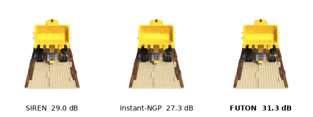

# Radiance fields

`inro.nerf` turns any model of the zoo into the density network of a radiance field, trains it on posed images by volume rendering, and scores held-out views. The protocol is FINER's, which is torch-ngp's Blender recipe: 200 × 200 views, 25 training views, scored on all 200 test views, here trained for 25,000 steps instead of 37,500. This follows `configs/nerf.yaml` and `scripts/train_nerf.py`.
{ .inro-lead }

<figure markdown="span">
  { width="720" }
  <figcaption>The lego scene rendered in orbit by SIREN, Instant-NGP and FUTON at equal parameter count (about 75k), with the test-view PSNR.</figcaption>
</figure>

<ol class="inro-flow">
  <li><strong>Rays</strong>from posed views</li>
  <li><strong>Samples</strong>along each ray, in an occupancy grid</li>
  <li><strong>Density network</strong>any model of the zoo</li>
  <li><strong>Color network</strong>features and view direction</li>
  <li><strong>Volume rendering</strong>a pixel, against the target</li>
</ol>

## Data

```python
import torch
import inro

root = "data/nerf/blender/lego"
train_set = inro.nerf.BlenderDataset(root, split="train", downsample=4, skip=4)
val_set = inro.nerf.BlenderDataset(root, split="val", downsample=4)
test_set = inro.nerf.BlenderDataset(root, split="test", downsample=4)
```

- `downsample=4` reduces the 800 × 800 renders to 200 × 200 by area averaging, and `skip=4` keeps 25 of the 100 training views.
- Camera positions are scaled by `scene_scale=0.8` into the box `[-bound, bound]^3` with `bound=1`, marching starts at `near=0.2`, and the background is white.
- `dataset[i]` returns a full view's rays and RGBA, and `sample_rays` draws random rays across views for training without materializing a ray buffer.

## Field and renderer

```python
field = inro.nerf.RadianceField(
    density_net=(inro.FUTON, {  # (1)!
        "basis": ("cosine", {"num_components": 100, "grid_size": 2048}),  # (2)!
        "combiner": ("cp", {"rank": 180}),
        "head": ("mlp", {"hidden_layers": 1, "hidden_features": 64}),
    }),
    color_net=("mlp", {"hidden_features": 64, "hidden_layers": 2}),  # (3)!
    geometry_features=15,
    direction_encoding="sh",
    aabb=train_set.aabb,
)
renderer = inro.nerf.create_renderer(aabb=train_set.aabb, near=train_set.near, far=train_set.far)
```

1.  Receives `in_features=3` and `out_features=1 + geometry_features`: one density logit and 15 features, on positions mapped from the scene box to $[-1, 1]^3$. The field applies `trunc_exp` to the density, so the network has no output activation.
2.  Samples along rays lie on no grid, so FUTON's basis would be evaluated at every one of them. `grid_size=2048` reads it from a table of 2048 points per axis instead, each coordinate rounded to the nearest, 0.001 apart and finer than the marching step, which keeps a trained field's PSNR within a few hundredths of a decibel and renders and trains it in a fraction of the memory.
3.  Maps the features and the encoded view direction to RGB (`"sh"`: 16 real spherical harmonics, as in Instant-NGP; `"identity"`: raw directions, as in FINER). The field applies a sigmoid, so it has no output activation either.

Every model in the benchmark shares this color network and renderer; only the density network changes, so the comparison is between spatial representations.

`create_renderer` picks nerfacc when its CUDA extension works and the pure-PyTorch renderer otherwise. Both march rays through an occupancy grid (`grid_resolution=128`, updated every 16 steps) with a step of $\sqrt{3} \cdot \text{extent} / 1024$ and at most `max_samples_per_ray=1024` occupied samples.

## Training

```python
result = inro.nerf.train(
    field,
    renderer,
    train_set,
    eval_dataset=val_set,
    eval_indices=[0, 25, 50, 75],
    num_steps=25000,
    num_rays=4096,
    lr=1e-2,
    eval_interval=2500,
    log_dir="logs/tutorial/lego/FUTON",
)
```

Each step updates the occupancy grid, renders 4096 random training rays, composites predictions and targets onto a random background color, and takes an Adam step, with PyTorch's default settings and the learning rate decaying exponentially to `lr / 10`. A run of 25,000 steps takes FUTON a few minutes on an A100.

| Output | Content |
| --- | --- |
| `history` | `step`, `elapsed`, `loss`, the training `psnr` and `num_samples` every `log_interval` steps, and the mean validation metrics under `"eval"` every `eval_interval` |
| `log_dir` | The field's `checkpoint.pt` and `renderer.pt`, the renderer's state with its occupancy grid: load both to render a saved run as it was scored |

Learning rates in `configs/nerf.yaml` range from 3e-4 (SIREN, FINER) to 3e-2 (Instant-NGP, TensoRF-VM, GA-Planes), with FUTON at 1e-2.

## Evaluation and rendering

```python
scores = inro.nerf.evaluate(field, renderer, test_set)  # PSNR, SSIM and LPIPS on all 200 views
print(scores["mean"])
```

`scores["views"]` holds one record per view with its index, render time and metrics; `return_images=True` adds the rendered `(H, W, 3)` images; `indices` selects a subset. `metrics` accepts any `fn(pred, target)` on `(3, H, W)` images in $[0, 1]$.

To render new viewpoints, build camera-to-world poses and call `render_views`:

```python
import imageio.v2 as imageio

poses = [inro.nerf.pose_spherical(theta, -30.0, train_set.radius) for theta in range(0, 360, 12)]
frames = inro.nerf.render_views(field, renderer, test_set, poses)  # list of (H, W, 3) uint8 arrays
imageio.mimsave("lego_orbit.gif", frames, duration=0.083, loop=0)
```

`render_image(field, renderer, rays_o, rays_d)` renders arbitrary rays, returning RGB, opacity and depth.

## The benchmark script

`scripts/train_nerf.py` trains every model of the config on every scene under `data/nerf/blender/`, evaluates on the 200 test views, each rendered whole in one pass, and saves two rendered test views per run. The NeRF sweep is the long one: about five minutes per model and scene on an A100, 112 runs in all.

```bash
python scripts/train_nerf.py --data data/nerf/blender/lego --models FUTON
```
