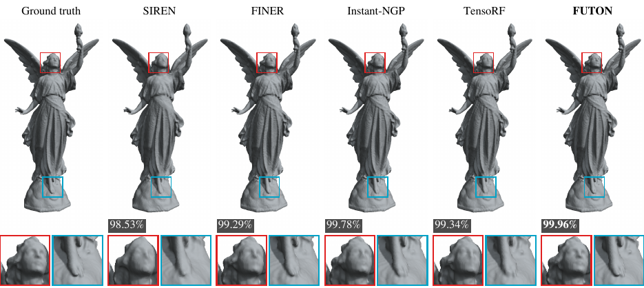

# Occupancy volumes

A shape is represented as an occupancy INR $[-1, 1]^3 \to \{-1, 1\}$, fitted to a voxelized mesh and scored by intersection over union. This follows `configs/occupancy.yaml` and `scripts/train_occupancy.py`.
{ .inro-lead }

<figure markdown="span">
  
  <figcaption>Lucy at about 131k parameters: every featured model's reconstruction with its IoU over the whole volume, and two regions magnified beneath it.</figcaption>
</figure>

## Data

`OccupancyCoordinateDataset` loads a mesh (any format trimesh reads, with the `3d` extra) or an `.xyz` point cloud with normals, and then:

<ol class="inro-flow">
  <li><strong>Normalizes</strong>into [&#8722;0.45, 0.45]&sup3;, as BACON and FINER do</li>
  <li><strong>Marks</strong>each voxel center, <code>resolution</code> per unit length, inside or outside the shape</li>
  <li><strong>Crops</strong>to the occupied bounds, as WIRE does</li>
  <li><strong>Caches</strong>beside the source, as <code>.cache/&lt;name&gt;_&lt;resolution&gt;_centers.pt</code></li>
</ol>

```python
import torch
import inro

path = "data/occupancy/lucy.ply"
train_set = inro.OccupancyCoordinateDataset(path, resolution=512, max_samples=2**20)
eval_set = inro.OccupancyCoordinateDataset(path, resolution=512)

eval_set.input.shape, eval_set.target.shape  # (depth, H, W, 3) coordinates, (depth, H, W, 1) targets in {-1, 1}
eval_set.original.shape                      # (1, depth, H, W) float occupancy in {0, 1}
```

A mesh's centers are tested with rays, a center being inside when most of five rays from it cross the surface an odd number of times, which tolerates the small holes of scanned meshes; a point cloud's take the sign of BACON's signed distance. Only centers decide, so a voxel that the surface merely crosses stays empty and thin parts keep their thickness. At 512 voxels per unit length a cropped volume holds 17 to 62 million voxels; `max_samples=2**20` trains on 1,048,576 of them at random per step, as many for every shape. The five meshes of the benchmark are the Stanford armadillo, dragon, happy buddha, lucy and thai statue, fetched by `scripts/download_meshes.py`.

## Model

The benchmark FUTON uses half the voxels along each axis of the cropped grid, a linear head, and the largest CP rank, a multiple of 5, that keeps it smaller than every baseline, the smallest of which has 131,585 parameters. Rank $R$ costs $R$ times the components plus one, and the head's bias adds 1, so Lucy's $268 \times 154 \times 461$ grid gets 295, for 130,391 parameters:

```python
components = [size // 2 for size in eval_set.grid_size]
rank = (131_584 - 1) // (sum(components) + 1) // 5 * 5
model = inro.FUTON(
    3, 1,
    basis=("cosine", {"num_components": components, "grid_size": eval_set.grid_size}),
    combiner=("cp", {"rank": rank}),
    head="linear",
    output_activation=torch.tanh,
)
```

On the voxel grid, which `grid_size` declares and which the crop sizes differently for every shape, the basis is evaluated once, when it is built, and each point reads its rows. The linear head contracts the whole grid at once when it has at most 64 cells per voxel of the batch, and otherwise combines each voxel's features from its rows. With $2^{20}$ voxels per step, every benchmark shape takes the whole grid, and so does every full evaluation pass: Lucy's 19 million cells are 18 per voxel, the armadillo's 62 million 59.

## Training and evaluation

```python
result = inro.train(
    model,
    train_set,
    eval_set,
    num_steps=1000,
    lr=3e-2,
    metrics={"iou": inro.iou},
    chunk_size=2**20,  # (1)!
    log_interval=50,
    eval_interval=50,
    save_reconstruction=False,
    log_dir="logs/tutorial/lucy/FUTON",
)
print(result["history"][-1]["eval"]["iou"])  # (2)!
```

1.  Voxels per evaluation pass, as many as per step: it bounds the memory of evaluating the whole volume.
2.  `inro.iou` thresholds the model's output at zero and compares it with the `{0, 1}` original.

Every model's IoU after the 1000 steps, and FUTON's convergence, are on the [benchmarks page](../experiments/benchmarks.md#occupancy).

## Exporting a mesh

With the `3d` extra, `eval_set.save(volume, path)` smooths the occupancy, runs marching cubes, writes a `.dae` mesh and renders it offscreen to a `.png` with Open3D, drawing the grid's axis `up` upwards: Lucy stands along the last, the other four shapes along the second, the default.

```python
volume = inro.chunked_inference(model, eval_set.input, chunk_size=2**20)
occupancy = eval_set.postprocess(volume.cpu())  # (1, depth, H, W) in {0, 1}
eval_set.save(occupancy, "lucy_futon", up=2)    # lucy_futon.dae and .png
```

!!! note "Rendering needs EGL and a GPU driver"

    Not every machine has them, which is why the call above and the benchmark script pass `save_reconstruction=False` and rebuild meshes from `checkpoint.pt` afterwards, with `inro.evaluate(model, eval_set, ckpt_path=..., log_dir=...)` on a workstation.

## The benchmark script

```bash
python scripts/train_occupancy.py                                       # all shapes, all models
python scripts/train_occupancy.py --data data/occupancy/lucy.ply --models FUTON
```

FUTON's ablations run on images; the [ablations page](../experiments/ablations.md) reports them.
